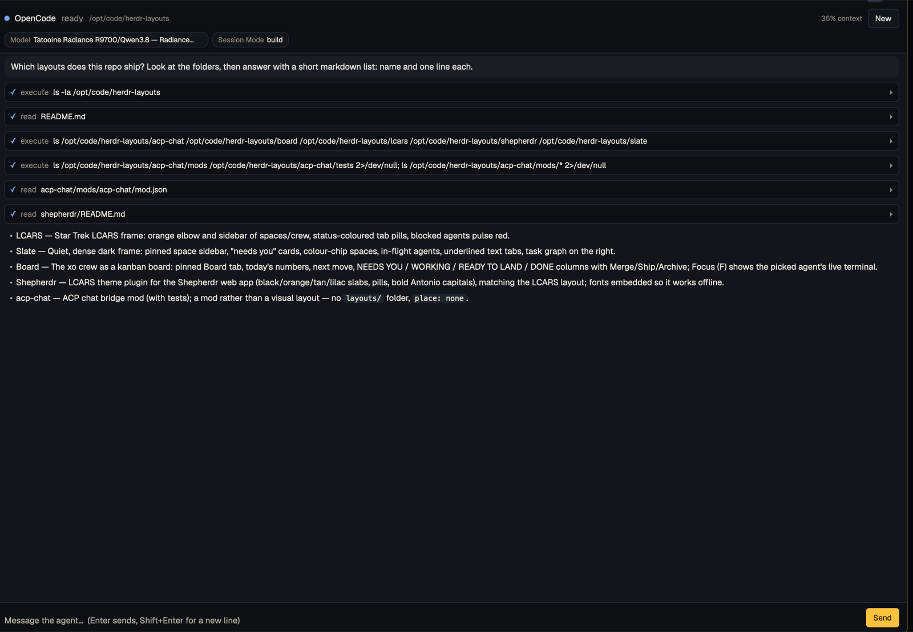

# ACP Chat

A chat pane for coding agents that speak the [Agent Client Protocol](https://agentclientprotocol.com): Oh My Pi (`omp acp`), OpenCode (`opencode acp`), the Claude Code and Codex ACP adapters, Gemini CLI, or any command you type. `cmd-shift-j` opens a small dialog to pick the agent and folder; the chat then opens as a pane beside your terminal. It streams the agent's replies as markdown, shows each tool call as a card, puts approval requests up as buttons, and lets you switch the agent's model and mode, including local models your agent already knows about. Closing the pane stops the agent; reopening a chat resumes the agent's own session when the agent can load one.

## What you see

The pane uses the theme's colours throughout (`surface` behind, `chrome` for the header and message box, `raised` for your messages, `background` for tool cards).

1. **New agent chat** dialog (560×470): the folder the agent will run in (the focused terminal's folder, with **Change…** for the system folder picker), one row per known agent with a green dot when it is installed (found on the login shell's `PATH`) or "not installed" plus an install hint, a field for any other command, **Open chat** and **Cancel**. **Open chat** splits a chat pane to the right of the focused pane.
2. **Header**, two lines:
   - a status dot (green ready, grey stopped) or a braille spinner while working, the agent's name from its `initialize` reply, its status, the folder, the share of the context window used (when the agent reports it), and **New** (opens the dialog for another chat pane).
   - one chip per option the agent offers for the session (`Model`, `Mode`, …), showing the current choice. A click opens a picker under the header: a filter field and the choices, the current one ticked.
3. **Messages**, scrolling, newest at the bottom:
   - your message in a rounded `raised` box;
   - the agent's reply as markdown, selectable;
   - thinking in dim italic, folded to its last two lines (click to open);
   - tool calls as cards: a status icon (`○` pending, `◐` running, `✓` done, `✗` failed), the tool kind and its title; a click shows its output or diff (first 4,000 characters);
   - the agent's plan as a checklist;
   - notes from the chat itself (stopped, token limit, errors) in small coloured text.
   Scrolling up stops following new output and shows **↓ Latest**.
4. **Approval card**, above the message box while the agent waits: the tool's title and one button per option the agent offers (allow buttons in the theme's solid colour).
5. **Message box**: a textarea that grows to 8 lines, with **Send**, or **Stop** while the agent works. When the agent has stopped, it shows the reason and **Restart agent** / **New chat** instead.

## How it behaves

- **Enter** sends, **Shift+Enter** adds a line. Sending is ignored while the agent works; **Stop** sends ACP `session/cancel` and answers a waiting approval as cancelled.
- The pane follows new output until you scroll up.
- Picking a model or mode sends `session/set_config_option` (or `session/set_mode` for agents that only report modes); the chip updates when the agent confirms.
- Each pane is one chat, named by its `chat` prop, so the layout keeps it across restarts.
- Closing the pane, or quitting Herdr, stops the agent. **Restart agent** starts it again in the same folder and resumes its session (`session/load`) when the agent supports that; otherwise it starts a new session under the old messages and says so.
- On a Herdr with `spawn` (see below), the agent runs inside the mod: no Node.js, no bridge. A hot reload or a Herdr restart stops it and the chat resumes on its own. Without `spawn`, a hot reload finds the running bridge again, and if Herdr goes away without closing the pane (a crash), the bridge stops itself within 10 minutes.

## Built from

- **Mod** `acp-chat` with two faces. As an overlay (`mod.json`: `{"place": "none", "overlay": {"width": 560, "height": 470}}`; `keys.json` binds `cmd-shift-j` / `ctrl-shift-j` to `mod.open:acp-chat`; **New** calls `openOverlay`) it is the dialog, and **Open chat** runs `pane.split {"direction": "right", "mod": "acp-chat", "props": {"chat": <new id>, "agent": <argv>, "cwd": <folder>}}` and closes itself. As a pane it is the chat: `chat` names it, `agent` (an id from the list or an argv array) starts it the first time, `cwd` is its folder. A pane opened without `chat` shows the setup in place and keeps one chat in its `localStorage`.
- **`session.js`** holds the agent session (initialize, resume, prompts, approvals, model and mode), with no Node or Herdr APIs, so it runs in either of two places, picked by `typeof herdr.spawn === "function"` (a named import of `spawn` would fail to load on Herdr builds without it):
  - **With `spawn`** ([herdrdev/herdr-app#723](https://github.com/herdrdev/herdr-app/issues/723); not in a release yet, built from the `feat/mod-spawn` branch of [jkuepker/herdr-app](https://github.com/jkuepker/herdr-app)): the mod starts the agent with `spawn`, writes with `processWrite`, reads `processNextLine` in a `cx.spawn` loop and keeps `state.json` (at most every second) only to resume. `close()` kills it with `processKill`; Herdr also stops a copy's programs when it closes or reloads.
  - **Without it**, **`bridge.mjs`**, a small Node program, runs the session, because a mod's `exec` can't keep a program running. The mod starts it with `hc run --bg --no-parent --name acp-chat-<chat> -- <node> bridge.mjs --dir <chat folder> -- <agent argv>`, so it lives in herdr-core like any terminal, and stops it with `hc kill` in the view's `close()`.
- **Files** under `~/.config/herdr-app/data/acp-chat/chats/<chat>/`: the bridge writes the whole chat to `state.json` (atomically, at most every 80 ms); the mod sends commands as files in `inbox/` (`prompt`, `cancel`, `permission`, `config`, `stop`) with `writeTextFile`, watches the folder with `watchFolder` and reads `state.json` with `readTextFile`. The mod touches `lease` every minute; the bridge stops when it goes stale.
- **`acp.js`**: JSON-RPC over newline-delimited stdio. **`transcript.js`** folds `session/update` notifications into the message list. Both have no Node or Herdr APIs, like `session.js`.
- `herdr` functions: `exec`, `hc`, `appHome`, `home`, `focused`, `props`, `theme`, `settings`, `pickFolder`, `readTextFile`, `writeTextFile`, `watchFolder`; `fs/promises` for `mkdir` and the lease. `gpui-base`: `TextareaState`/`Textarea`, `InputState`/`Input`, `TextView.markdown`, `Scrollbar`, `VirtualListScrollHandle`; `gpui-kit`: `list` (rows of any height).
- The client tells agents it has no file system or terminal of its own (`fs`/`terminal` capabilities off), so agents use their own tools.

## Watch out

- Without `spawn` it needs **Node.js** on the login shell's `PATH` for the bridge, and it runs the agent through it: the agent sees the bridge's environment (the folder from `--cwd`, the core's environment), not the pane's. With `spawn` the agent gets Herdr's own environment.
- **This computer only.** `watchFolder` and `writeTextFile` have no `on`, so a chat for a space on another machine isn't supported yet.
- `readTextFile` reads at most 1 MiB: the bridge keeps `state.json` under 800 KB by dropping the oldest messages and shows how many it dropped.
- A mod textarea's Enter inserts a newline and then fires `submit` (with `shift` for Shift+Enter); the send trims it. `submit_on_enter` isn't exposed to mods.
- Herdr keys a mod copy's `localStorage` by a hash of its props, so two panes opened with the same props share it: that's why every chat pane gets its own `chat` prop.
- `list` rows can't hold their own click handlers: item clicks go through `on_item_click` by key, so the approval buttons live outside the list.
- Agents differ: OpenCode doesn't ask before running tools by default; omp's default model may be one you have no access to (pick another in the Model chip). Some agents echo your message as `user_message_chunk`; the bridge ignores those while its own turn runs.
- Claude Code and Codex need their ACP adapters installed separately (`claude-code-acp`, `codex-acp`).

## Done when

- `herdr-app check ~/.config/herdr-app/mods/acp-chat` passes.
- `node --test acp-chat/tests/*.test.mjs` passes (the bridge and `session.js` against a scripted fake agent: streaming, model change, allow/reject, cancel, stop, resume and the no-resume fallback).
- `cmd-shift-j` shows the dialog with the installed agents; **Open chat** opens a pane beside the focused one. Two chat panes hold two separate chats.
- A chat pane with an installed agent shows its name, `ready`, and its Model chip; a prompt that makes the agent read a file shows a `✓` tool card and a markdown reply.
- An approval request from the agent shows the card with its buttons; **Allow** finishes the tool.
- Closing the pane leaves no `acp-chat-*` terminal in `hc ls` (without `spawn`) or agent process (with it); **Restart agent** on a stopped chat with OpenCode shows "Resumed the agent's session." and the old messages.
