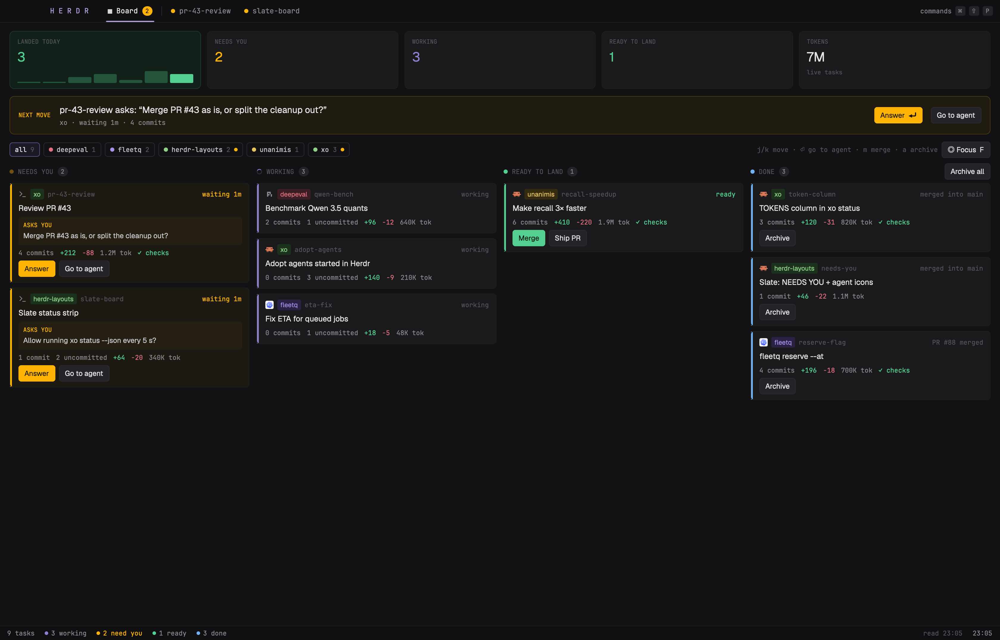

# Board

The xo crew as a board in Herdr. A pinned **Board** tab, with a yellow badge counting the tasks that need you, opens one screen that shows:
- what needs you, with the question each agent asks,
- what's working,
- what's ready to land,
- what's done and can be archived,
- today's numbers.

**Focus** (F) fades everything except NEEDS YOU and opens the picked task's live terminal beside the board, so you can answer without leaving it. Built for an ADHD brain: one next move, one place to look, archiving in one key.



It reads [xo](https://github.com/jkuepker/xo) through its CLI, as the `xo-bridge` mod does. It needs an xo with `xo bearings --rows` and `xo act` (branch `herdr-mode` today).

## What you see

Slate's palette (see [Slate](../slate/RECIPE.md)): near-black `#121214`, JetBrains Mono for labels and numbers, Geist for titles.

1. **Top bar, 38px.**
   - `H E R D R` in lilac.
   - **▦ Board** with a yellow count badge when something needs you. It is the pinned first tab.
   - A divider, then the shown space's tabs. Blocked tabs get a yellow dot, working ones a spinner.
   - The active one (Board or a tab) is underlined in lilac `#b4a0db`.
   - In Focus, tabs that don't need you fade.
   Under it, on the left, the **spaces sidebar** (220px): the main layout's spaces list, grouped by machine, with **+** on each machine for a new space there. `cmd-b` hides and shows it, and dragging it under 160px turns it into the narrow rail.
2. **Today strip.** Five equal boxes:
   - `LANDED TODAY`: the count in green, on a green tint, with 7 bars for the last 7 days (today solid, the rest at 30%).
   - `NEEDS YOU` (yellow `#ffb406`), `WORKING` (purple `#8f7fd1`), `READY TO LAND` (green `#53cf91`).
   - `TOKENS`: every listed task's tokens added together.
3. **NEXT MOVE.** A yellow-bordered banner, shown while anything needs you:
   - the task that has waited longest, with `<slug> asks: “<question>”`,
   - its project, how long it has waited and its commits,
   - **Answer ⏎** (Focus on it) and **Go to agent**.
4. **Project chips.** `all n`, then one chip per project with its colour dot and count, plus a yellow dot when a task there needs you. A click filters, and a second click clears. The key hint and the **◎ Focus F** button sit on the right.
5. **Four columns.** NEEDS YOU (pulsing yellow dot), WORKING (spinner), READY TO LAND (green dot), DONE (blue dot, with **Archive all**). Each scrolls on its own. A card has a 3px left bar in its column's colour, and the selected card gets a `#625187` border. Each card shows:
   - the agent's icon (Herdr's program icon for its harness), the project chip, the task slug and a timer:
     - `waiting 6m` (yellow), from the tab's `changed_at`,
     - `12m` working, from `working_since`,
     - `ready`,
     - or the done reason.
   - the title: the first line of the task's brief.
   - in NEEDS YOU, an `ASKS YOU` box with the question read off the agent's screen.
   - facts in mono: commits, uncommitted files, `+added −deleted` (when xo reports them), tokens, and checks (`✓ checks`, `✗ checks`, `checks stale`).
   - buttons:
     - NEEDS YOU: **Answer** and **Go to agent**.
     - any column but NEEDS YOU: **Sync**, **Merge PR**, **Merge** and/or **Ship PR**, whichever xo's `next` names (`xo sync`, `xo land`, `xo merge`, `xo ship`), plus Go to agent.
     - DONE: **Archive**.
   - while an action runs, `Merge…` with a spinner. A failure stays on the card with its first line.
6. **Ready to push.** Under the chips, one line per project whose branch is ahead of origin (a bearing of kind `push`, keyed by the project): `life  main is 2 commits ahead of origin  [Push]`. A dirty checkout gets the line without the button. A project with merged task branches left (kind `clean`) gets `xo  2 merged branches to clean up (xo/a, xo/b)  [Clean]`, which runs `xo clean`. With one project's chip picked, **Release** shows beside Focus (`xo cut`, a patch release).
7. **Status bar, 24px.** Task counts by group, any xo error in red, when xo was last read, and the clock.

## How it behaves

- **Reads:** `xo bearings --rows`, plus `xo log --json --lines 1000` for the landed counts. It reads again:
  - when xo writes `state.json` or `events.jsonl` in its home (watched),
  - when an `xo=worker` terminal changes status,
  - after an action ends,
  - and every 15s anyway.
- **Questions:** every 5s it runs `hc read` on each blocked hc task and takes the lowest line that ends in a question, the same rule as Slate.
- **Actions** use `xo act <key> <do> --id <id>`, then poll `xo act --state <id>` every 2s.
  - Merge, Ship PR, Merge PR (`land`) and Archive (`remove`) ask on the card first: `Archive token-column? [Yes y] [No n]`. Sync does not ask: it only touches the task's own branch.
  - Push, Clean and Release take the project as the key (`xo act life push`) and ask on their line: `Push life to origin? [Yes y] [No n]`.
  - **Archive all** asks once for every DONE card.
- **Go to agent:** `agent.focus {terminal}`, then `layout.select {stack: "main", child: "work"}`, so the work area shows that task's tab. Clicking Board switches back.
- **Focus:** `agent.focus` on the picked NEEDS YOU task, then `layout.show {id: "focus-term"}`, which is a `{ "agent": "focused" }` block. Every other column, the strip and the chips fade to 18%. Picking another NEEDS YOU card switches the terminal. Esc or F hides it again.
- **Spaces:** picking a space in the sidebar (or with `cmd-p`) while the board shows switches to its terminal, as Go to agent does. With the side terminal open the board stays, and the side shows that space's tab. Focus moves the space itself, so it leaves the board alone.
- **Side terminal:** `cmd-alt-b` (`layout.toggle:side`) opens the active tab's terminal on the right of the board, 640px.
- **Keys** (once you click the board): `j`/`k` or arrows move, `⏎` goes to the agent, `f` toggles Focus, `f` again (after clicking the board) leaves it: Esc in the terminal goes to the agent, `m` merges, `a` archives, `y`/`n` answer a confirm.
- **Commands** (for `keys.json` or `herdr-app do`): `board.focus`, `board.unfocus`, `board.next`, `board.prev`, `board.go`, `board.merge`, `board.archive`, `board.yes`, `board.no`. They reach the board only while it shows: a hidden stack child doesn't run. To get back to the board from a key, bind `layout.select {"stack": "main", "child": "board"}` in `keys.json`.
- **Settings:** `local.json` beside the installed mod sets the xo to run: `{"xo": "/opt/code/xo/.worktrees/herdr-mode/.venv/bin/xo"}`. Add `"home"` to set `XO_HOME`.

## Built from

- **`layouts/board.json`:** Slate's colours and pane frame. A `column` root holds:
  - `top`: 38px, `window_drag`, the mod with part `top`.
  - `body`: a row holding:
    - `sidebar`: a 220px `column` (min 44, max 480, chrome background) holding the `spaces` mod. The id must be `sidebar`: the spaces mod picks its narrow rail from that node's width, and `cmd-b` toggles it.
    - `main`: a `stack` with `active: "board"`. Its children are `board` (the mod, part `board`) and `work` (`"tab": "active"`).
    - `focus-term`: `{ "agent": "focused" }`, 640px (min 360, max 1000), `hidden: true`.
    - `side`: `{ "tab": "active" }` with the work pane's frame, 640px (min 360, max 1000), `hidden: true`.
  - `bottom`: 24px, part `bottom`.
- **`mods/board/main.js`:** one mod for all three parts.
  - The board part reads xo and writes `shared("board.counts")`, which the top and bottom parts draw.
  - It also writes `board.view` and `board.focus`. The top bar writes `board.left` when it sends a picked space to the work view, so the board's next draw doesn't mark the view `board` again.
  - Herdr functions: `exec`, `readTextFile`, `watchFolder`, `knownAgents` (agent icons), `agents`/`spaces` (timers), `nextCommand` and `run`.
- **`mods/board/spinner.svg`:** Slate's arc.

## Watch out

- **Two layout rows need a plain flex row** (`div().flex().flex_row()`): the today strip and the columns. `h_flex` centres its children, which shrinks each column to its header and gives the card list no height.
- **Mods have no `setTimeout`.** Use `cx.timer` or state checked on the 1s tick.
- **`{ "agent": "focused" }` shows only terminals Herdr has in a tab.** A terminal started with `hc run` and no tab can't be focused, so test terminals go in a space (`herdr-app do space.new {argv}`). xo's hc tasks get a tab per task.
- **A hidden stack child doesn't draw or take commands.** The top bar, always shown, switches views itself, and the board marks `board.view` when it draws again.
- **The layout remembers a shown `focus-term` across reloads.** The board hides it when it starts, to match its own state.
- **`hc send` refuses blocked terminals.** That's a guard for real permission prompts. Answer those yourself in Focus.
- **Two blocks show the active tab** (`work` and `side`). The stack hides `work` while the board shows, so only `side` draws then. Opening `side` from the work view shows the same tab twice.
- **Data xo doesn't give yet:** cost and agent-time-today. `+added −removed` come from xo's `lines` (the fixture still sends `added`/`deleted`).

## Testing without agents

[`fixture/fake-xo`](fixture/fake-xo) answers `bearings --rows`, `log --json` and `act` with the 9 mockup tasks, and logs every `act` to `acts.log`. It keeps its files in `<repo>/.worktrees/board-fixture/` (git-ignored). There, `sessions.json` maps two NEEDS YOU tasks to test terminals, which are `sh` scripts that send `OSC 7501 state=blocked` and print a question. To use it, point the installed `local.json` at it (`{"xo": "/opt/code/herdr-layouts/board/fixture/fake-xo"}`), then:

```bash
herdr-app do layout.switch '{"name":"board"}'
herdr-app do board.focus
```

## Done when

1. `herdr-app check ~/.config/herdr-app/mods/board` passes.
2. The board shows the fixture's 9 tasks in 2 / 3 / 1 / 3. NEXT MOVE quotes the question from the first test terminal.
3. `board.focus` fades everything except NEEDS YOU, `herdr-app status` shows `"agent"` set to that task's terminal with its screen beside the board, and typing there answers it.
4. `board.go` on a NEEDS YOU card shows that task's tab, and `layout.select {stack: main, child: board}` brings the board back with the Board tab underlined.
5. `board.next` ×7, `board.archive`, `board.yes` writes `xo/token-column remove --id …` to `acts.log` and leaves DONE at 2.
6. Against real xo, `xo bearings --rows` answers and the status bar says `read HH:MM` with no error.
