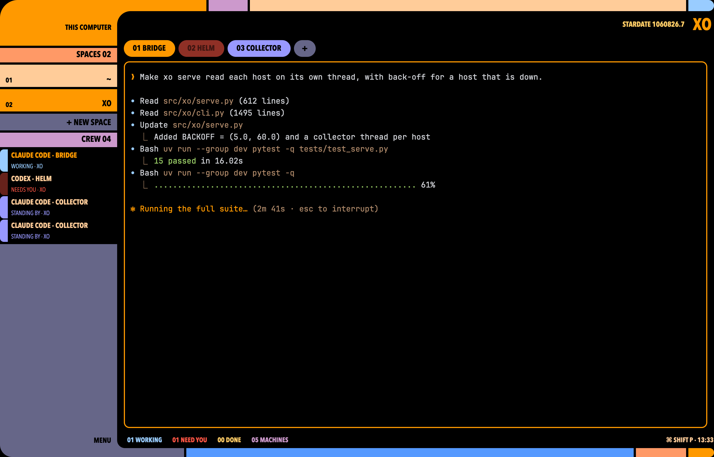

# LCARS

A Star Trek LCARS frame around your terminals. A black window has an orange elbow in the top-left corner that runs down into a sidebar of flat colour slabs: your spaces as big buttons, then a "crew" list of every agent with a status strip. A grey `+ NEW SPACE` slab under the spaces asks which machine to put it on. A coloured arm runs across the top under the space name, which is set in large orange capitals next to a stardate. Tabs are round pills coloured by what their agent is doing. Terminals sit in thin rounded frames, and the focused one is ringed in orange. A grey elbow closes the bottom-left corner, and its arm carries a count of agents working, needing you and done, plus the clock. An agent that needs you blinks red in the sidebar and on its tab.

## What you see

The whole window is black (`#000000`). All labels are bold (weight 700) capitals in Antonio, the classic LCARS face, which the mod brings with it. LCARS blocks are separated by 4px of black.

1. **Top bar, 64px tall, full width.** It is a window drag area.
   - Left: a 210px orange (`#ff9900`) elbow with a 44px rounded top-left corner. Its bottom-right corner reads the shown space's machine, or `THIS COMPUTER`, in 13px black.
   - Right of the elbow, a 20px arm made of four slabs: orange 160px, lilac (`#cc99cc`) 70px, tan (`#ffcc99`) filling the rest, and blue (`#99ccff`) 46px with rounded right ends (10px).
   - Under the arm, a black area with a 26px rounded top-left corner cut into the orange. This gives the inner curve of the elbow. It is right-aligned and holds `STARDATE nnnnnnn.n` in 13px gold (`#ffcc66`), then the shown space's name in 30px orange.
2. **Sidebar, 210px wide, between the top and bottom bars.**
   - An 18px orange slab that carries the elbow down.
   - A 26px peach (`#ff9966`) label slab, `SPACES nn`.
   - One 40px slab per space. The label sits bottom-right in 15px black, with the index and machine (`01`, `02-SPARK1`) at the left in 12px. The shown space is orange. A space whose agent needs you is red (`#ff5544`). The others cycle tan, lilac, peach, blue, violet (`#9999ff`).
   - A 30px grey slab, `+ NEW SPACE`, which turns violet on hover.
   - A 26px lilac label slab, `CREW nn`.
   - One 40px row per agent:
     - A 14px status strip at the left, rounded on its left side.
     - Then two lines. The first, in 13px, is `PROGRAM · TAB` in tan, or orange for the focused agent. The second, in 11px in the status colour, is `STATUS WORD · SPACE`.
   - Grey (`#666688`) fills the rest down to the bottom elbow.
3. **Work area, right of the sidebar, with 8px/12px padding.**
   - **Tab row, 30px.** Each tab not put away (settled) is a pill with a 15px radius and 16px side padding. Its label is `nn NAME` in 14px black. Then comes a grey `+` pill that turns violet on hover.
   - **Panes.** The active tab's panes have an 8px gap and a 10px radius on a black background. Each pane has a 2px grey border, orange when focused. A lone pane keeps its frame.
4. **Bottom bar, 44px tall, full width.**
   - Left: a 210px grey elbow with a 40px rounded bottom-left corner, labelled `MENU` top-right in 13px black. It turns violet on hover.
   - Right of it, a black area with a 22px rounded bottom-left corner cut into the grey. It holds 12px counts, from the left: `nn WORKING` in blue, `nn NEED YOU` in red (grey when 0), `nn DONE` in gold and `nn MACHINES` in lilac. At the far right sits `⌘ SHIFT P · HH:MM` in tan (`CTRL SHIFT P` off macOS).
   - Under that, a 16px arm made of grey 120px, sky (`#5599ff`) filling the rest, peach 90px, and orange 46px with rounded right ends (8px).

**Terminal colours:** background `#000000`, text `#ffcc99`, cursor `#ff9900`, selection `#5a3a00`. The 16 ANSI colours use the same palette: red `#ff5544`, green `#99cc66`, yellow `#ffcc66`, blue `#5599ff`, magenta `#cc99cc`, cyan `#99ccff`, white `#ffcc99`, brights a step lighter.

## How it behaves

Each agent status shows the same colour in the crew strip, the tab pill and the status word:

| Status | Colour | Status word |
| --- | --- | --- |
| working | blue `#99ccff` | `WORKING` |
| blocked | red `#ff5544`, pulsing | `NEEDS YOU` |
| done | gold `#ffcc66` | `DONE` |
| idle | violet `#9999ff` | `STANDING BY` |
| no status | grey `#666688` | |

**Blocked pulses:**
- The crew strip pulses opacity 0.4↔1 every 700ms.
- A tab that isn't active pulses 0.5↔1 every 800ms.
- A space that isn't shown turns red and pulses 0.55↔1 every 900ms.

**The active tab is always orange,** whatever its status.

**Clicks:**
- A space slab: `space.select {id}`.
- A crew row: `agent.focus {terminal}`.
- A tab pill: `tab.select {id}`.
- `+ NEW SPACE`: with no other machines, `space.new` here. With machines added (`hc machine add`), a popup of LCARS slabs, `NEW SPACE ON` then `THIS COMPUTER` and one per machine. Picking one runs `space.new {machine}`. A machine that isn't ready shows grey with its state and can't be picked.
- `+` after the tabs: Herdr's new menu (terminal, each installed agent, new space, new worktree, open worktree).
- `MENU`: Herdr's global menu (new space, keybinds, themes).
- `⌘ SHIFT P`: `app.palette`.

**Right-clicks** open Herdr's own menu at the pointer:
- A space slab: rename, new worktree, open worktree, close.
- A tab pill: rename, new tab, close.
- A crew row: that agent's pane menu (split right or down, zoom, right-clicks to the program, close).
- A terminal: Herdr's usual terminal menu.

**Hovers:** every clickable dims to opacity 0.85. The `+` pill turns violet.

**Over time:** the stardate and clock update every 15s. The crew order follows the sidebar, through `setAgentOrder`, so `agent.next` and `agent.prev` walk it top to bottom.

## Built from

- **`layouts/lcars.json`:** a root `column` with `"titlebar": "none"`, `"traffic_lights": [226, 34]` (in the black under the top arm), `"theme": "graphite"`, a `colors` block that sets every theme colour and `ansi0`–`ansi15` (so no `themes/` file is needed), `"ui_font": "Antonio"` and `"preview": "mods/lcars/preview.png"`. Its children:
  - `top`: a block, `{ "px": 64 }`, `window_drag`.
  - `body`: a row with `resizable: false`, holding:
    - `sidebar`: a block, `{ "px": 210 }`.
    - `work`: a column with padding `[8, 12]` and gap 8. It holds `tabs`, a block of `{ "px": 30 }`, and `main`, a block with `"tab": "active"` and the pane frame (gap 8, radius 10, border `#666688` 2px, focus `#ff9900` 2px, `lone: true`).
  - `bottom`: a block, `{ "px": 44 }`.
- **One mod, `mods/lcars`** (`{ "place": "none" }`), used by all four blocks. `props().part` picks what it draws: `"top"`, `"side"`, `"tabs"` or `"bottom"`. Its code is one `View` class with a renderer per part. It uses `gpui-kit` `div` and `gpui-base` `h_flex` / `v_flex`.
- **The machine picker** is the same mod opened as a popup (`openOverlay {mod: "lcars", kind: "popup", frame: "none", props: {part: "machines"}}`), sized 230px wide and 60 + 44 per machine tall. It closes itself with `closeOverlay(props().overlay)` before running `space.new`.
- **`herdr` functions:** `spaces()`, `agents()`, `machines()`, `window()` (only its `platform`), `props()`, `run()`, `setAgentOrder()`, `openOverlay()` and `closeOverlay()`. It runs no programs and makes no network or file reads.
- **Shipped mods:** `menu` (right-click menus, opened with `props {tab: "space" | "tab" | "pane" | "global", target}`) and `new-menu` (the `+` popup). It replaces the tab bar, the sidebar and the status bar.
- **Art:** none. Every shape is a coloured `div` with per-corner radii (`rounded_tl`, `rounded_bl`, `rounded_tr`, `rounded_br`, `rounded_l`).

## Watch out

- **The elbows' inner curve** is a black child with a rounded corner sitting on an orange or grey parent. It is not a cutout. Keep the parent's colour the same as the elbow's.
- **`loop()` takes a policy object:** `.loop("opacity", { from, to, period })`. Positional numbers fail at render time. `herdr-app check` passes, and the part simply goes blank.
- **Theme:** a theme in `themes/` does not travel with a shared layout, so put the palette in the layout's `colors`.
- **`done` shows only until the tab is seen.** Herdr settles it to `idle`, so a screenshot rarely shows a gold `DONE`.
- **Antonio comes with the mod.** `mods/lcars/fonts/` holds Antonio Regular and Bold (latin, static TTFs from Fontsource) and their licence, the SIL Open Font License (`OFL.txt`). Herdr loads a mod's `fonts/` at start, so nothing needs installing.
- **The sidebar has a fixed width (210px) and doesn't scroll.** In an 820px-tall window about 14 rows fit, spaces and crew together. More are cut off. Long names are truncated.
- **The top arm's orange, lilac and blue slabs have fixed widths** (160, 70 and 46px). Only the tan slab shrinks.
- **Menus are Herdr's, not LCARS-styled.** They keep the app's own look, so rename, close, split and worktrees behave exactly as in Herdr's layouts.
- **A hidden window doesn't redraw.** `herdr-app shot` returns the last frame drawn, so bring the window forward before taking a screenshot.
- **The stardate is invented:** the year minus 1920, then the fraction of the year so far.

## Done when

1. `herdr-app check ~/.config/herdr-app/mods/lcars` passes.
2. `layout.switch {name: "lcars"}` shows the frame, and `herdr-app status` lists no errors.
3. A terminal that sends `OSC 7501 state=blocked` turns its crew strip and tab red and pulsing, and raises the `NEED YOU` count.
4. Clicking a crew row focuses that terminal. Clicking a space slab switches to that space, and the big title changes to its name.
5. `+` after the tabs opens Herdr's new menu. Picking Terminal adds a pill.
6. `+ NEW SPACE` opens the machine picker when machines are added. Picking `THIS COMPUTER` adds a space slab and shows it.
7. `MENU` opens the global menu. Right-clicking a space, tab or crew row opens its menu.
