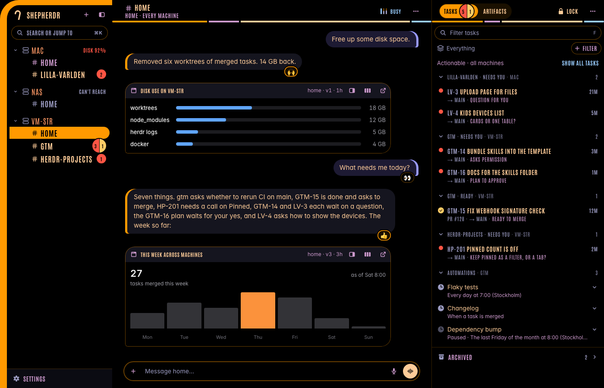
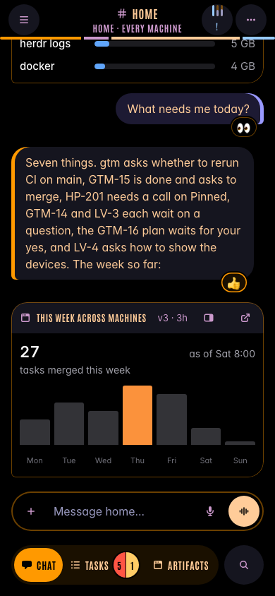

# LCARS for Shepherdr

A Star Trek computer theme for [Shepherdr](https://github.com/eliasstravik/shepherdr)'s web app, matching the [LCARS layout](../lcars/) for the Herdr app. Black screen, orange, tan and lilac slabs, pill shapes, bold capitals in Antonio.



Phone:



## What it changes

- **Colours.** Every colour variable of Shepherdr's `src/styles.css` is set, for both `:root` and `:root[data-theme=dark]`, so light and dark look the same: black. Body text is tan (14:1 on black), second-level text lilac (9:1), the faintest text a grey-violet (7.8:1). Status keeps its meaning: working is blue, needs you is red, ready is gold, merged is violet. The terminal, diffs and code take LCARS colours too.
- **Type.** Buttons, tabs, menus, headers, the sidebar and headings are bold capitals in Antonio. Chat and message text, the message box, code, file paths and the terminal keep their readable faces (Inter and monospace): Antonio is condensed, and a paragraph in capitals is slow to read.
- **Shapes.** An orange elbow at the top left of the sidebar running down as a bar (the phone's drawer too); the open space is a solid orange slab with black words; a thin segmented orange, lilac, tan and blue bar under each header; toggles and tabs are pills with the picked one orange; the agent's message bubbles carry an orange bar on the left and yours a violet one on the right; the message box and menus have an orange keyline.
- **Bar colour.** The phone's status bar and the browser's bar stay black in both appearances.

The fonts are embedded in the plugin (`fonts.ts`, about 60 KB), so it works offline, on a tailnet for one.

## Install

```sh
mkdir -p ~/.shepherdr/plugins && cp -R shepherdr/plugins/lcars ~/.shepherdr/plugins/
```

Shepherdr rebuilds and restarts within seconds, and open screens reload themselves. Update by copying the folder again.

## Turn it off

Settings → Plugins, switch `lcars` off (or put `{ "off": ["lcars"] }` in `~/.shepherdr/plugins.json`). Delete `~/.shepherdr/plugins/lcars` to remove it.

## Notes

- Shepherdr has no theme slot, so this is a plugin (`client.tsx`) that renders a `<style>` from the `overlays` slot, as `docs/plugins.md` describes. It needs no server part.
- The CSS hooks on Shepherdr's own markup (`nav[aria-label=Places]`, `[data-chrome]`, `[data-msg]`, `[data-composer]`, `aria-pressed`, `aria-current` and a few Tailwind class names). If an update to Shepherdr renames them, the colours and fonts still apply and only the shapes fall back to the stock look.
- Artifacts (the cards an agent shows in a chat) are the agent's own HTML in a frame and follow the light or dark appearance, not this theme. In dark mode they sit well on black; in light mode they stay white.

## Regenerating the fonts

`plugins/lcars/fonts.ts` is generated from the Antonio TTFs of the Herdr LCARS mod:

```sh
bun gen-fonts.ts
```

## Credits

[Antonio](https://github.com/googlefonts/antonioFont), copyright 2013 The Antonio Project Authors, under the SIL Open Font License 1.1 (`plugins/lcars/OFL.txt`). LCARS is the interface design of Star Trek: The Next Generation (Michael Okuda); this is a fan homage with its own code.
