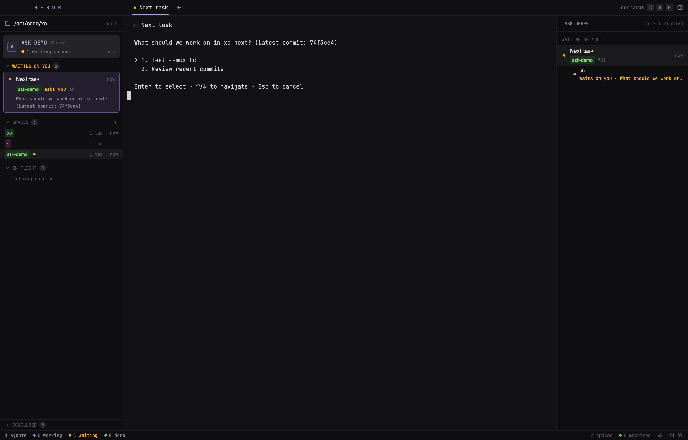

# Slate

A quiet, dense dark frame around terminals. The left sidebar shows the shown space pinned as a card. Under it, every agent waiting on you gets its own card with the question it asks. Then come every space as a coloured chip and every working agent. Agents that are done or idle fold away under CONCLUDED at the foot of the sidebar. Tabs are plain monospace text along the top, and the active one is underlined in lilac. On the right, a task graph lists the shown space's tabs, grouped by status, with the agents in each tab on tree lines. A one-line status bar sits at the bottom.

## What you see

The window is near-black. Titles are in Geist, 13px. Everything else is in JetBrains Mono, 10 to 13px: section headers, chips, status words, counts and times. Both fonts ship with Herdr. Regions are separated by 1px `#1e1e20` lines.

1. **Top bar, 38px, full width, `#101012`.** It is the window drag area.
   - Brand cell, 300px wide (it lines up with the sidebar): `H E R D R` in 12px bold lilac (`#b4a0db`), letter-spaced. On macOS it starts 84px in, after the window buttons.
   - Tabs: one per tab that is not put away (settled), in 13px mono, 10px side padding. The active tab is `#e4e4e7` with a 2px lilac underline. The others are `#8a898e` and brighten on hover. A tab whose agent is working, blocked or done shows its status mark (see below) before its name.
   - A grey `+` after the tabs.
   - Right side: `commands` with the keys `⌘ ⇧ P` (`Ctrl Shift P` elsewhere) as small `#242328` key caps, then a panel-right icon.
2. **Sidebar, 300px (drag between 220 and 440), `#0f0f11`.**
   - Header, 40px: a folder icon and the shown space's folder (home shown as `~`), plus its git branch in dim mono when it has one.
   - Pinned card: a `#242328` rounded (6px) card with 8px margin.
     - A 24px avatar square with the space's first letter in lilac and a `#625187` border.
     - The space name in bold lilac capitals, then `@machine` (or `@local`) in dim mono.
     - A second line, for this space only: a yellow dot and `n waiting on you` when its agents are blocked, otherwise a green dot and `n working`. The time since the space last changed sits on the right.
   - `WAITING ON YOU n`, shown only while an agent is blocked. Its header is in yellow (`#ffb406`). Each blocked agent is a card, 8px in from both sides with 6px between cards. The card is `#1a1720` (`#241f2e` on hover or when focused), 6px radius, with a 1px `#625187` border, and has three lines:
     - The pulsing yellow dot, the row title (see below) and the time.
     - Indented: the space chip, `asks you` in yellow and the program name.
     - Indented: the question the agent asks, in 11px `#8a898e` mono, wrapping, cut at 160 characters with `…`. This line is left out when no question is found.
   - `SPACES n`, a collapsible section header: a chevron, the name in dim mono capitals and a count badge. A `+` on the right makes a new space.
     - One 26px row per space: the name as a chip, a pulsing yellow dot when an agent there needs you, `n tabs` and the time since it last changed. The shown space's row is highlighted `#1a1a1d`.
   - `IN FLIGHT n`: every working agent. Each row has two lines:
     - The status mark and the row title (13px Geist).
     - Indented under it: the space chip, the status word in its colour, the program name and the time.
     - The focused agent's row is highlighted.
   - `CONCLUDED n`: done and idle agents.
   - **Row titles:** the tab's name when someone named it. Otherwise, use what the program titled its terminal, with leading symbols such as `✳` removed. If the title is just the terminal's address, use the program's name instead. This keeps an unnamed tab from showing as `1`. Folded, it is pinned to the foot of the sidebar above a 1px line. Unfolded, it lists those agents like IN FLIGHT.
3. **Work area:** the active tab's panes. They sit on `#121214` with 6px gaps, 6px radius and a 1px `#1e1e20` border; the focused pane's border is `#625187`. A tab's only pane gets no frame.
4. **Task graph, 320px (drag between 240 and 480), `#0e0e10`.**
   - Header, 40px: `TASK GRAPH` and `n live · m running`.
   - The shown space's tabs (titled like the sidebar's rows), grouped under `WAITING ON YOU`, `RUNNING`, `LANDED` and `IDLE` (empty groups are left out). Each tab row has:
     - The status mark, the tab name, the space chip, `#nn` and `n panes`.
     - The time it started working or last changed, on the right.
   - Under each tab, every agent in it on a `├`/`└` tree line: the program name, then the status word in colour, plus the question for a blocked agent, or else the terminal's title when the program set one.
5. **Status bar, 24px, `#0e0e10`.**
   - Left: `n agents`, `n working` (purple dot), `n waiting` (yellow dot; the text turns yellow when it is above 0), `n done` (green dot).
   - Right: `n spaces`, `n machines`, a settings gear and the clock.

Spaces and agents get their chip colour from a hash of the space name, so a space keeps its colour. Each chip is a coloured text on a dark tint of the same colour, 3px radius. The eight colours are:

| Name | Text | Background |
| --- | --- | --- |
| red | `#e0707f` | `#3b1d24` |
| teal | `#3ec9b4` | `#11302d` |
| orange | `#f0a050` | `#3a2410` |
| purple | `#a690e8` | `#2a2245` |
| gold | `#e6c35c` | `#352c10` |
| blue | `#6fb3f2` | `#152a40` |
| pink | `#e88cc8` | `#3a1a30` |
| green | `#8fd18a` | `#1c321c` |

Terminal colours: background `#121214`, foreground `#e4e4e7`, selection `#3a3150`. The ANSI colours reuse the chip text colours: red `#e0707f`, green `#53cf91`, yellow `#e6c35c`, blue `#6fb3f2`, magenta `#a690e8`, cyan `#3ec9b4`, white `#c8c8cc`. The brights are a step lighter.

## How it behaves

| Status | Mark | Colour | Word |
| --- | --- | --- | --- |
| working | spinning arc (900ms a turn) | purple `#8f7fd1` | `working` |
| blocked | dot, pulsing 0.35↔1 every 900ms | yellow `#ffb406` | `waits on you` |
| done | circle check | green `#53cf91` | `done` |
| idle | dot | dim `#56555b` | `idle` |

**The question:** every 5s the sidebar runs `hc read <address>` for each blocked agent; that prints the terminal's screen as plain text. It strips leading frame and bullet characters (`│ ╭ ╰ ─ ❯ › > ⎿ ⏺ ● • ◆ □ ☐ ✳ *`) from each line, then takes the lowest line that:
- is at least 10 characters long,
- contains a letter,
- has a `?` followed by a space, `)` or the end of the line,
- doesn't start with `?` and doesn't mention `shortcuts`.

It shares the answers as `shared("slate.asks")` (address → question), so the task graph shows them too. It only writes them when they changed.

**Clicks:**
- A tab, or a tab row in the task graph: `tab.select {id}`.
- A space row: `space.select {id}`.
- An agent row, a waiting card, or an agent leaf in the task graph: `agent.focus {terminal}`.
- A section header folds or unfolds that section (kept per mod copy, not saved).
- `+` after the tabs: Herdr's new menu. `+` in SPACES: `space.new`.
- `commands`: `app.palette`. The panel icon: `layout.toggle {id: "panel"}`, which hides or shows the task graph. The gear: `app.settings`.

**Right-clicks** open Herdr's own menu mod:
- A space row or the pinned card: the space menu.
- A tab, or a tab row in the task graph: the tab menu.
- An agent row or waiting card: the pane menu.
- Anywhere else: the global menu.

The agent order follows WAITING ON YOU, then IN FLIGHT, then CONCLUDED, through `setAgentOrder`, so `agent.next` and `agent.prev` walk the sidebar from top to bottom.

## Built from

- **`layouts/slate.json`:** a `column` root with `titlebar: "none"`, `traffic_lights: [14, 13]` (the top edge of the 12px buttons, centring them in the 38px bar), `theme: "graphite"`, the colours above, `font: "JetBrains Mono"`, `ui_font: "Geist"` and `preview: "mods/slate/preview.png"`.
  - `top`: a block of `{ "px": 38 }`, `window_drag`.
  - `body`: a resizable row with a 1px `#1e1e20` divider, holding:
    - `sidebar`: a block of `{ "px": 300 }`, min 220, max 440.
    - `main`: a block of `"tab": "active"` with the pane frame (gap 6, radius 6, background `#121214`, border `#1e1e20` 1px, focus `#625187` 1px, `lone: false`).
    - `panel`: a block of `{ "px": 320 }`, min 240, max 480.
  - `bottom`: a block of `{ "px": 24 }`.
- **One mod, `mods/slate`** (`{ "place": "none" }`), used by all four mod blocks. `props().part` picks what it draws: `"top"`, `"side"`, `"panel"` or `"bottom"`. It uses `gpui-kit` `div`/`svg` and `gpui-base` `h_flex`/`v_flex`.
- **`herdr` functions:** `spaces()` (including each tab's `changed_at` and `working_since` for the times), `agents()`, `machines()`, `window()` (only its `platform`), `props()`, `run()`, `setAgentOrder()`, `openOverlay()`, `home()`, `shared()`/`setShared()` and `exec()`. The one program it runs is `hc read <address>` (screen only, no history), for blocked agents every 5s. It makes no network requests and reads no files.
- **Shipped mods:** `menu` (right-click menus, opened with `props {tab: "space" | "tab" | "pane" | "global", target}`) and `new-menu` (the `+` popup). It replaces the tab bar, sidebar and status bar.
- **Art:** Lucide icons copied into `mods/slate/` (`folder`, `chevron-right`, `chevron-down`, `plus`, `circle-check`, `settings`), plus two drawn for this layout: `panel-right.svg` (a rounded rectangle split near its right side) and `spinner.svg` (a faint circle with a quarter arc, turned with `.spin(900)`). They are tinted with the text colour through `svg()`.

## Watch out

- **Colours must be real colours.** `"transparent"` makes a view fail to render; use `#00000000`.
- **Letter-spacing is faked with thin spaces**, and in a monospace font each one is a full cell wide. Only the brand uses it. Section headers are plain capitals.
- **Herdr's times are `changed_at`/`working_since` on the tab, not the agent**, so every agent in one tab shows the same time. Before anything changes after a start, times are blank.
- **The task graph only shows the shown space.** It shows settled tabs only when they are blocked.
- **The terminal title is often just its address.** Rows use the tab name as their title and show the terminal title only when it differs from the address.
- **The question is a guess from the screen.** A program that asks without a `?`, or draws its question above a longer list that has one, shows the wrong line or none. Remote agents are read through their `machine/t7` address.
- **The sidebar's lists scroll; the pinned card and the CONCLUDED footer do not.**
- **Menus are Herdr's, not restyled**, so rename, close, split and worktrees behave exactly as in Herdr's own layouts.
- **A hidden window doesn't redraw.** `herdr-app shot` returns the last frame drawn, so bring the window forward before taking a screenshot.

## Done when

1. `herdr-app check ~/.config/herdr-app/mods/slate` passes.
2. `layout.switch {name: "slate"}` shows the frame, and `herdr-app status` lists no errors from `slate`.
3. A terminal that sends `OSC 7501 state=blocked` and prints `What should we work on next?` gets a WAITING ON YOU card with that question, and shows under WAITING ON YOU in the task graph, and raises `n waiting` in the status bar, and in the pinned card when that terminal's space is shown.
4. A terminal that sends `state=working` shows a spinning arc in IN FLIGHT and under RUNNING.
5. Clicking an agent row focuses its terminal. Clicking a space row switches spaces, and the pinned card and folder change with it.
6. The panel icon hides and shows the task graph. `+` after the tabs opens Herdr's new menu.
7. Right-clicking a space, tab or agent row opens its menu.
