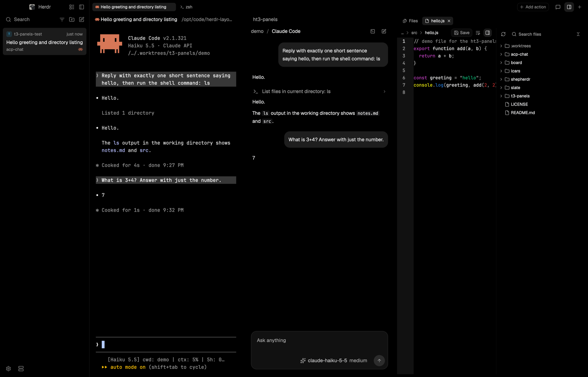

# T3 Panels

T3 Code's chat and its right side panel (Files, Diff, terminals, pull requests, Browser, a side chat) inside the Herdr T3 layout, with T3 Code's colors. A chat pane opens beside a terminal: it shows the conversation of the Claude Code or Codex already running there, or starts an agent of its own over the Agent Client Protocol (Oh My Pi, Pi, OpenCode, …). The side panel slides in on the right, a strip of tabs with a `+` menu over Files (the folder as a tree, files edited and saved in place), a diff, real terminals, pull requests, a browser launcher and a chat; it splits in two, and a bottom panel holds a terminal. Two themes, `t3code-dark` and `t3code-light`, give the whole layout T3 Code's palette.

It is a whole layout, `herdr-t3-panels`: [Herdr T3](https://github.com/JinJieBeWater/herdr-t3)'s frame (a sidebar that is an Inbox of agent cards or lists of Spaces and Agents, slim tabs, framed pane headers, an Actions button) with the chat, the panels, a dashboard surface and a command palette built into it. Someone who already runs Herdr T3 can add only the panels: `layouts/README.md`.



## What you see

Everything uses T3 Code's sizes (1rem = 16px): 14px text on a 23px line, 8px control corners, 16px card corners.

0. **The frame**, Herdr T3's, left to right with a 1px `border` divider:
   - a **sidebar** (256px, 208 to 480, `chrome`): a 40px brand bar (Herdr's mark and name go Home; two 28px buttons switch the list and fold the sidebar), then one of two lists, then a 44px footer of 32px icon buttons (Settings, Pull request, Changes, Add machine). The **Inbox** (the layout opens on it): a 32px Search row with a space filter, new-folder and new-chat buttons, and under it a row of filter chips (status; machine and project once the cards come from more than one); cards for the agents that need you (the space's mark and name, the state or the time, the title, the branch with the agent's icon), and folded Working, Snoozed and Settled shelves. **Lists**: Spaces (grouped by machine once there is more than one, worktrees under their repository) over Agents (by space or by priority, pinned ones first);
   - a **work column**: a 40px tab row (the shown space's tabs, 24px high, 6 round, the active one filled; then **Add action**, the four panel buttons and a `+`), the panes of the shown tab, each with a 28px header (program icon, name, branch, split and close), and an 8px inset below. Herdr's shipped `workspace-status` bar is in the layout, hidden.
   Their full description is Herdr T3's own `RECIPE.md`; this file describes what this build adds and changes.
1. **Four buttons** in the tab bar, right of the layout's own (28px square, 8 round, muted icons): a speech bubble (New chat), maximize (the side panel over the whole work area; minimize while it is), a bottom panel and a side panel (the last two filled with an accent ring while they show).
2. **New chat** dialog (512×660): a 20px semibold title, then rows 32px high with 8px corners. "Running in this tab" lists the Claude Code and Codex terminals of the shown tab (a dot: blue working, amber waiting). "Start an agent" shows the folder the agent will run in with **Change…**, one row per ACP agent enabled in Settings, with the agent's own icon (dimmed with an install hint when it isn't installed), and a field for any other command. A sliders button beside the title opens Settings. **Cancel** and a blue **Open chat** sit in a footer under a line.
3. **Chat pane**, a 736px lane centered in the pane:
   - a 40px header, as T3 Code's: the folder's two-letter badge (blue on 16% blue, 16px, 4 round) and name in muted text, `/`, the thread's title (the first message, at most 80 characters; the agent's name until there is one), a small badge while it is Starting, Waiting for you or Stopped (none while it works: the timeline says "Working for 3s", as in T3 Code), the share of the context window used, a button to go to the agent's terminal (when it has one) and New chat;
   - your messages right-aligned in a bubble (at most 80% wide, 16 round, 12 in, the theme's `raised`);
   - the agent's replies as plain markdown, no bubble;
   - under each of your messages, once its turn is done, a muted "Worked for 1.6s" with a chevron over a hairline: a click opens the turn's work rows under it; the answer stays below (a turn with no work rows shows the time alone, with no chevron). A turn that ends with nothing said gets an amber row: "The agent ended the turn without a reply. Check its model or its sign-in." (Pi does this when its model can't be reached). What an agent says before any message (Pi's version, skills and extensions) folds the same way under "Startup notes";
   - its work as flat rows 24px high (a thought shows its own first line): a 16px icon by kind (eye read, pen edit, terminal run, magnifier search, globe fetch, brain thinking, wrench other), a muted one-line label and a chevron; a failed one is red with an ×. A click opens what it printed in 12px mono;
   - a plan as a card (16 round, 16 in) with a checkbox per step;
   - notes (resumed, stopped) as 11px words between two hairlines; errors as a red row;
   - while it works, "Working for 12s" in muted text over a hairline, counting, right under your message with the work rows below it;
   - scrolled up, a "Scroll to end" pill over the bottom.
4. **Composer**: a card (16 round, 1px outline at 8% of the text color, the theme's `surface`) with "Ask anything. @ files, $ skills, / commands" (T3 Code's words; typing one of the three opens its menu, see below), two lines high, growing to eight. Under the text, right-aligned: one control per option the agent offers (28px high, a 16px icon, the current choice: model, effort, mode; the model's control leads with the agent's own icon, and a model named by its path shows without the path: `my-server/my-model (big box)` reads "my-model (big box)"; the menu lists whole names) and a 32px round button: blue with an up arrow to send, grey when there is nothing to send, red with a square to stop. A control's choices open as a menu above the composer (320 wide, 28px rows, a search field when there are more than eight, a check on the current one).
5. **Approval drawer**, tucked on top of the composer while the agent waits: "Waiting for approval" with an amber shield, the tool's title, and one 24px button per answer (the allowing ones blue).
6. **Side panel** (540px, 360 to 3000, on the right of the work area; a 1px split line in the theme's `border` color separates it, no frame around it). One or two **groups** stacked, each a 40px **strip** and a body, with a draggable line between the groups:
   - the strip (RightPanelTabs.tsx): tabs 24px high (max 144, 6 round, 2px between the parts), the shown one filled; a tab starts with a 16px box holding its 12px icon, which becomes the × while the pointer is on the tab; then a **+** and, in the first group, a **branch button** and, in each, a **split** button;
   - the **+ menu** (ui/menu.tsx: 216 wide, 28px rows, 4 round, a 16px icon, the letter as bare 12px muted text): Browser (B), Terminal (T), Files (F), Diff (D), Pull request (P), Linked pull requests (L), Device (M, at 64% with its reason as tooltip) and Side chat (S). A surface that doesn't apply where the space works now is greyed the same way, with why as its tooltip: Diff, Pull request and Linked pull requests in a folder outside a git repository; the two pull request rows without `gh` or without a remote on GitHub; Side chat when Settings enables no agent. The letter opens it while the menu is open; the arrows move over the rows that can open (not the greyed ones, whose letters do nothing) and Enter opens the marked one; Esc closes. The menu closes at once; a terminal shows a moment later. An empty group shows the same list in the middle ("Open a surface": at most 320 wide, 32px rows, 8 round, the letter in a 20px chip, hover at 60% of the accent fill);
   - **Files**: the folder as a tree. With a file open, a 32px strip shows above it: the explorer switch (`panel-left`; `ht3-panels.tree` does the same), then the open files, with no Files tab of its own since the side panel's tab already names the surface; a 28px line with the last folders and the name, "Unsaved", **Save**, Lines and word wrap; the file in an editor (13px mono, line numbers, folding, T3 Code's syntax colors: `pierre-dark` on a dark theme, T3 Code's `t3-light` on a light one); the explorer 224px wide on the left of the file. The explorer: refresh, a "Search files" field, collapse all; rows 24px high, 12px text, 6 round, 12px of indent per level, **file-type icons** (the git mark for `.gitignore`, Markdown, TOML, the Claude starburst for `CLAUDE.md`, and the rest of @pierre/trees' set), git marks as a letter (green A, amber M, red D or U), and **Git-ignored** files and folders (`.venv`, `.pytest_cache`, `.worktrees`, `node_modules`) dimmed. With no file open it fills the panel;
   - **Terminal**: a real Herdr terminal in the folder Files shows (else the focused terminal's, else the space's). Any number; tabs "Terminal 1", "Terminal 2", …; × ends it. Not a tab or pane of the work area;
   - **Diff**: a 40px header with "Working tree", `N files changed`, the total +/− (11px mono) and two 28px buttons; a section per file (a collapsible 32px header with its icon, path, Added/Deleted/Renamed and +/−), then its hunks: a `@@ -a,b +c,d @@` line, and lines with old and new line numbers on a gutter, green for added and red for removed, with comments, strings, numbers, keywords, types and calls in T3 Code's code colors. New files show as added. The header has T3's layout toggle (two 28px icon buttons, rows and columns), collapse all and refresh. **Unified** is one column; **Split** puts the old file on the left and the new on the right, each with its own line numbers: within a hunk a run of removed lines goes against the run of added lines after it, line by line, and the shorter side is padded with an empty grey cell (`diff.js` `pairLines`). A row is one pair, so both sides scroll together. A surface narrower than 640px shows Unified whatever is chosen, and the Split button, dimmed, says so on hover. The choice is kept as `diffLayout` (`"split"`, else unified) in `ht3-settings.json`; for scripts `ht3-panels.view:split|unified`;
   - **Pull request**: the pull request of the folder's branch (`gh pr view`): state (Open green, Draft grey, Merged purple, Closed red), number, title, head → base, author, +/−, files, age, **Open on GitHub**, the checks (a row each with its state, "24/25 passing"), the reviews and the review decision, the description as markdown. **Linked pull requests**: your open pull requests in the repository (`gh pr list --author @me`), the branch's own marked, a click opens one in the browser. Without `gh`, without a sign-in, without a GitHub remote or without a pull request, each says so in the middle of the panel. **Start chat from PR** (T3's PullRequestThreadDialog; `pr.js`): the **Start chat** button of the Pull request surface, the chat icon on each Linked row, and `ht3-panels.prChat`, a dialog (512 wide) that asks for a number or the pull request's GitHub address (`ht3-panels.prChat:<number or address>` starts at once and answers with a notification). It asks GitHub for the pull request (`gh pr view <n> --json`) and its review threads (`gh api graphql`, reviewThreads: path, line, resolved, outdated, what was said), makes the worktree `<repo>/.worktrees/pr-<number>` on a branch `pr-<number>` with the launcher's `addWorktree` (so `.worktrees/` is ignored the same way, under the main checkout even when asked from a worktree), puts the head there with `gh pr checkout <address> --branch pr-<number> --force` and, where that fails (a fork gh can't reach, no gh), `git fetch <the remote that is the pull request's repository> pull/<number>/head` and `git reset --hard FETCH_HEAD`, runs the project's worktree setup script (`setupWorktree`) and opens a chat tab named `PR #<number>` there on the agent New chat comes up with. The chat's message box holds, **not sent** (`props.seed`): number, title, address, head → base, author, size, the description, the reviews that say something, the open review threads each under `### path:line` (resolved ones left out and counted, outdated ones last) and the comments; at most 16,000 characters, a description 6,000 and one comment 1,200, what doesn't fit is left out and a last line says how many of each are there and that `gh pr view <n> --comments` shows the rest. A folder `.worktrees/pr-<number>` that is already there (or a branch `pr-<number>` left from before) is reused untouched, and the line under the surface's title (or a notification) says so. If the checkout fails the new worktree and branch are removed again. All `gh` and `git` run on the space's machine. In words, on the line under the title or in the dialog: gh missing, not signed in, no such pull request, a repository or fork you can't read, an address whose repository is no remote of the folder, a folder outside Git, no agent installed;
     **CI drill-down** (`pr.js`, with `ci-log.js`, which has no Herdr imports): in the Checks section a check that is still going shows a spinning "running" (or "queued") and the surface asks GitHub again every 30 s while its tab shows, and stops once every check has finished (then it looks only every two minutes, as the rest of the page). A **failed** check that is a GitHub Actions job (its details URL is `…/actions/runs/<run>/job/<job>`) has **Log**: a step of the surface, with Back, shows `gh run view <run> --log-failed --job <job> -R <owner/repo>` cleaned up (ANSI colors, the byte order mark and GitHub's timestamps removed, `##[group]` → `▸ …`, `##[error]` → red `error: …`, `##[endgroup]`/`##[debug]` dropped, blank runs collapsed, lines cut at 400 characters), the job and step names as headers (a step GitHub can't name, "UNKNOWN STEP", shows the job only), the **last 300 lines** in a monospace list scrolled to the end, and a line saying how many of how many are shown. A job that didn't fail outright (cancelled) falls back to `--log --job`. A failed check of other CI (no run to ask about: a commit status, CircleCI, …) has **Open** instead, which opens its details URL in the system browser like every link here. When any check failed, **Re-run failed** opens a confirmation step listing the runs (`gh run rerun <run> --failed -R <owner/repo>` for each distinct run), and after Re-run failed the checks are asked again at once and 4 s later; the line under the title says how many runs restarted or why GitHub refused (no permission, the run still going). **Fix with agent** (in the Checks section, for the first failed job with a run, and in the Log step) puts a short prompt ("The CI check … failed (PR #n, branch …). Find the cause in the log below and fix it in this folder; don't push.") and the failure log, at most 150 lines and 14,000 characters, into the message box of the chat in the shown tab, through shared `ht3-panels.quote` exactly as the Diff's "Add to chat" does (not sent; if the shown tab isn't a chat the line says so). Without `gh` or a sign-in the surface says so as before; a log that expired, a run still going or an unknown run says so in the Log step. `ci-log.js` holds `runIdOf`, `failedRuns`, `cleanText`, `parseLog`, `logRows`, `fixPrompt` and `explainRun`.
   - **Browser**: Herdr has no web view, so: an address field that opens the page in the system browser, the servers listening on this computer (one click each), and the pages opened lately;
   - **Side chat**: a short list of the ACP agents enabled in Settings, then a chat; its tab then shows the agent's own icon in place of the chat bubble (the × still takes its place on hover) (the same as the chat pane) in the folder; × ends the agent and forgets the conversation;
   - the **branch button** (first group, right) opens a popover (344 wide): the machine's name with the folder and a Finder button, **Open in Cursor** with the app's own icon (taken once from its bundle with `sips` into `data/ht3-panels/editor-icons/`; else the first of VS Code, VSCodium, Zed that is installed and enabled in Settings, else Finder; a chevron lists the others), a hairline, the git branch, which opens the **branch picker** (BranchPicker.tsx; `branches.js`): a filter field and a list under the row, local branches first (the current one ticked, the newest commit first, from `git for-each-ref --sort=-committerdate`), then the branches only a remote has; Enter or a click runs `git switch <b>` (a remote one `git switch --track <remote>/<b>`), and when what is typed matches no branch exactly a **Create branch <name>** row comes first and runs `git switch -c`. A dirty tree that blocks the switch shows git's own message in red under the list and the step stays open. A branch another worktree has checked out can't be switched to: its row says which folder, and has **Open chat** when a chat of this mod works in that folder (its tab is found in `shared("ht3-panels.programs")`), else it is greyed with the reason; **Pull request** (in a repository with a remote on GitHub; opens that surface), **Changes** with the lines added and removed in green and red mono (opens Diff; counted as T3 Code does: against the merge base with the default branch, files not yet tracked included, through a throwaway index), and at the bottom, under a hairline, **Settings**.
7. **Settings** dialog (640×680, `ht3-panels.settings`, the sliders button of New chat, the popover's Settings row), drawn as T3 Code's settings pages: a 20px title and ×, then sections with a 16px semibold title and a 12px muted line over a card (12 round, 1px outline, rows parted by hairlines, each a 14px medium title, a 12px muted line and its control at the end; switches 28×16). **Agents**: a row per ACP agent with its icon, its command or "not installed", **Default** (a chip on the one New chat and Side chat come up with) or **Make default**, "All 83 models" / "2 of 83 models" with a chevron, and a switch; the chevron opens that agent's models as 28px checkbox rows (name, id in mono; the ticked ones first once there is a list), **Show all**, and above the list a field that filters it as you type, with **Add** for a model id the agent hasn't listed. **Editors**: a switch per editor. **Side panel**: "Start hidden in new spaces". A footer names the file.
8. **Bottom panel** (the bottom panel button or `cmd-j`): 240px under the work area's panes (not under the side panel), a terminal of the shown space, with "Open terminal" when the space has none.

## How it behaves

- **New chat**: the speech-bubble button or `cmd-shift-o` opens the dialog; **Open chat** opens the chat as a tab of its own in the focused space (named after the agent), filling the work area; split a terminal in beside it like any tab.
- **A terminal agent's chat** (Claude Code, Codex) follows the agent's own session log: it updates when the log grows. Enter types your message into the agent's terminal (also while it works; Claude Code is told to take it at once). The red button presses Esc there. When the agent waits on its own dialog, the drawer says so and offers **Go to terminal** and **Dismiss (Esc)**; the dialog itself is answered in the terminal. Closing the chat pane leaves the agent running.
- **An ACP agent's chat**: the pane starts the agent in the folder and talks to it directly. Enter sends, Shift+Enter adds a line; one message per turn. The red button cancels the turn. Approval requests show in the drawer with the agent's own answers. Picking a model, effort or mode tells the agent. Closing the pane stops the agent; opening the layout again resumes the agent's session when it can load one ("Resumed the agent's session."), else starts a new one under the old messages. A stopped agent shows why, with **Restart agent**.
- **A chat tab's agent is an agent to the layout's lists.** An agent started over ACP has no terminal, so Herdr doesn't count it; the chat tab reports for it (see Built from). It shows in the Agents list and the Inbox with the agent's icon, the thread's title and its space (in the Inbox as T3 Code's thread card: the space's mark and name, the state or the time, the title, then the folder's branch with the agent's icon), the tab-bar count of the hidden sidebar includes it, and its tab gets the status mark: **working** while it answers (spinner), **blocked** while it waits for an approval ("!", Needs you), **done** when a turn ended, or the agent stopped, while its tab wasn't the shown one in the front window (a dot), **idle** once you look and otherwise. A click on its row goes to its tab, in whichever space. `agent.next` / `agent.prev` walk terminals only and pass it by; the sidebar's own next/previous row keys include it. In the Inbox a chat's card is settled and snoozed as an agent's is, as T3 Code archives a thread: **Settle** (the card's button, or `cmd-shift-s` on the shown chat) moves it to Settled and leaves the tab open and its agent running; the key again, the row's undo, or new work (a message sent, a turn ended) brings it back. **Clear** closes settled terminal agents' panes but never a chat. Nothing in these mods closes a chat tab except its own × and closing its space. A side chat is not a tab and reports nothing. A chat of a terminal agent reports nothing either: its terminal already does. An agent that ends before it has a session says why above the message box, in red: "Couldn't start <program>: not found. Pick another agent with New chat, or see which are on in Settings." when its program is missing (the shell's 127), else its exit code and what it wrote last (`agent-acp.js` `startFailure`), with **Restart agent**, **New chat** and **Settings** buttons; the header says Stopped and nothing spins.
- **Settings** apply at once, everywhere: an agent switched off leaves New chat, Side chat's list and `chat:<agent>`; an agent's model list cuts its chats' model menu to those models (the one in use always shows); the default agent is the one both lists come up with; an editor switched off leaves the popover; "Start hidden in new spaces" hides the side panel the first time a space is shown. They are kept in `~/.config/herdr-app/data/ht3-settings.json`, written at each change and read again within two seconds of an edit by hand:
  `{ "agents": { "pi": { "enabled": true, "models": ["my-server/my-model"] }, "opencode": { "enabled": false } }, "defaultAgent": "pi", "editors": { "zed": false }, "sidePanelHiddenInNewSpaces": false }`.
  Agent ids: `omp`, `pi`, `opencode`, `claude`, `codex`, `gemini`; editor ids: `cursor`, `code`, `codium`, `zed`. Anything left out is its default (every agent and editor on, all models, the first installed agent, the panel as it was). An agent's models are known once a chat with it has started (they are remembered in shared `ht3-panels.models`); until then add ids by hand.
- Agent status in the header badge: working (blue "Working", and the counting line), blocked (amber "Waiting for you" and the drawer), stopped (red "Stopped" and the reason); idle and done show no badge.
- The timeline follows new output until you scroll up.
- **Files**: the side-panel button or `cmd-shift-e` shows and hides the panel. It shows the repository (else the folder) of the focused terminal, and keeps to it until a terminal somewhere else gets focus. Below the search row, the folder's path with **Up one folder** on its left; **Open folder…** (folder icon, this machine only) picks any folder, such as `~/code`. A folder chosen either way stays for that space (kept in shared state `ht3-files.pinned`) until **Back to the terminal's folder** (terminal icon, shown only then). A click on a folder opens it, on a file opens it in a tab (twelve at most). Typing in "Search files" lists matching paths from the whole folder.
- **Editing**: typing marks the tab with a dot and "Unsaved"; **Save** or `cmd-s` writes the file. If the file changed on disk meanwhile, a red line offers **Reload** and **Overwrite**. Closing an unsaved tab asks: **Keep editing**, **Close without saving**, **Save and close**. An open file without edits follows changes on disk.
- **The side panel's tabs**: the `+` opens the menu; a surface already open in the group is shown instead of opened twice (terminals open as many as asked). A click on a tab shows it, the × closes it (a terminal tab ends its terminal; closing the last tab leaves "Open a surface"). A terminal that ends by itself (`exit`, or `hc kill` from elsewhere) loses its tab within a few seconds (one on another machine within about 20). A terminal that doesn't start says why in a toast. Diff, the pull request surfaces and Browser look again on their timers only while their tab shows, and at once when it shows again. The tabs, which one is shown, the split and the panel's width are kept **per space** in shared state `ht3-side.state` (they survive reloads and restarts; switching space shows that space's own; a new space starts with Files and the width shown).
- **Split**: the button at the right of a strip adds a second group under the first, with a terminal in it; the line between them drags (and is kept per space as the first group's height). The button again merges the second group's tabs into the first; closing a group's last tab does the same. Each group has its own tabs and its own copy of Files, Diff and the rest.
- **Maximize**: the panel takes the whole work area, the chat and its panes hidden; again to come back to the width it had. The panel button hides the panel and with it the maximized view. `cmd-shift-e` still toggles the panel.
- **Bottom panel**: the bottom button or `cmd-j` shows a terminal under the work area's panes (started in the same folder rules as a side terminal, one per space; each space keeps its own while the panel is open), and hides it again; the line above it drags.
- **Folder**: Files, Diff, the pull request surfaces, new terminals and the side chat all use the folder Files shows (the folder pinned with **Open folder…** or **Up one folder**, else the focused terminal's repository). The pull request and diff look at the repository's current state and refresh on a timer (30 s, 15 s) and when files change.
- **Scripts and keys** (`herdr-app do "ht3-panels.<command>"`, or keys.json): `add:<kind>[:<group>]` (`browser`, `terminal`, `files`, `diff`, `pr`, `prs`, `checks`, `chat`; `add:terminal:bottom` is the bottom panel's terminal), `activate:<group>:<tab id>`, `close:<group>:<tab id>`, `split`, `max`, `bottom`, `chat:<agent id>[:<group>]` (starts the side chat's agent), `menu:add[:<group>]`, `menu:project`, `pin:<folder>` (`pin:` clears it), `settings` (the dialog), `set:<path>=<json>` (one setting, e.g. `set:agents.pi.enabled=false`; `set:<path>` alone puts it back to its default) and, while the `+` menu is open, `key:<key>` (`down`, `up`, `enter`, `escape` or a letter: the same as pressing it). While the Settings dialog is open: `ui:agent:<id>`, `ui:default:<id>`, `ui:models:<id>` (opens its models), `ui:model:<id>=<model id>`, `ui:allmodels:<id>`, `ui:editor:<id>`, `ui:side`, `ui:close`, each the same as the click. While the project popover is open: `open:<editor id>`. In the shown chat: `say:<text>` sends a message, `pick:<option id>` (`pick:model`) opens or closes that control's choices, `choose:<option id>=<value>` picks one, `answer:<answer id>` answers an approval, `stop` is the stop button and `fold:<row id>` opens or closes a row (`__startup`, `__worked-<message id>`, a work row's id). They go to the always-present buttons block; the strip, the `+` menu and the empty face send the same commands with `run("ht3-panels.<command>")`.
- A space on another machine: its files open read-only, and the panel says so. Files over 1 MB open as a read-only preview of their first 400 KB.

- **Copy and paste**: the message box is Herdr's text area, which has Cmd+C, X, V, A and Z of its own. A reply's text can be selected (`TextView.selectable`). gpui-kit allows no handler inside a list row, so what T3 draws as buttons on a message are rows of their own (`chat.js` `rows()`): a slim row with a copy icon under each message copies all of it, a header row over each code block of a reply copies that block (`segments()` cuts a reply at its fences), and the icon is a check for a moment afterwards. A right-click on a message, a thought or a tool's output opens a one-row Copy menu at the pointer (`on_item_secondary_click`, `menus.js` `CopyMenu`: Enter or C copies, Esc closes). For scripts: `ht3-panels.copy:last`, `copy:code`, `copy:<row id>`, `ctx:last` (that menu) and `paste` (the clipboard's text into the message box). The side chat is the same panel.

- **The lane follows its end**: gpui-kit's measured `list` can't be scrolled from code (its scroll handle is a virtual list's), so a chat in one stayed at its first message. The rows are a plain column pinned to the pane's bottom edge (`chat.js` `timeline()`): scrolling up moves the column down by pixels (`wheel()`), the last 60 rows are built and 60 more each time you near the first, new output doesn't move what you read further up, and the "Scroll to end" pill or scrolling back down follows again. A chat shorter than the pane starts at the top. Rows being plain elements, each has its own click and right-click. For scripts: `ht3-panels.scroll:<px>` (up; negative down), `scroll:end`. There is no scrollbar.
- **`/` commands and `$` skills** (chat/ComposerCommandMenu.tsx): when the text ends in a word that starts with `/`, a menu opens over the message box, as wide as it (rows 32 high: an icon, the name, what it does): T3's own that have a place here (`/model` opens the model menu, `/side` a side chat, `/new` the New chat dialog), then the commands the agent announced (ACP `available_commands_update`). `$` lists Claude Code's skills on disk where the chat runs (`~/.claude/skills` and the project's `.claude/skills`, each with its description) and the agent's commands named as skills. Typing narrows it; Enter or a click takes the marked row: T3's own run at once, anything else becomes `/name ` in the box so its arguments can follow, and Enter sends it as the prompt. The arrows, Tab and Esc are handled where the text area lets them through. The text area doesn't say where its caret is, so the word is the one the text ends in. For scripts: `ht3-panels.type:<text>`, `take:<n>`, `menu-key:<up|down|enter|escape>`.

- **`@` files** (chat/ComposerCommandMenu.tsx, FileTagChip.tsx): a word that starts with `@` lists the folder's files where the chat runs (`git ls-files -co --exclude-standard`, or `find` without git; listed again after 30 seconds): the file's icon, its name, its folder; names that start with what you typed first. Taking one puts a chip in the text (the text area's inline token; its text is `@path`), and on send each chip also goes to the agent as an ACP `resource_link` block (`file://` and the whole path); `session.js` `prompt(text, blocks)` takes those blocks, in both mods. A terminal agent's chat gets the `@path` text only.

- **Attachments** (chat/ComposerAttachmentStrip.tsx): drop files on the message box, press its `+` (the system's file dialog, through `osascript`; this computer only), or paste a picture (the text area's `paste_other`; the clipboard's picture is saved as a PNG in the chat's `attachments` folder). They sit in a strip over the text: pictures as 56px thumbnails (a 256px copy under Herdr's folder, since `image()` shows nothing outside it), other files as chips, each with an ×; at most 8. On send a picture goes as an ACP `image` block when the agent says it takes them (`promptCapabilities.image`; one over 1.5 MB is shrunk to 1568px JPEG first), everything else as a `resource_link`; the message shows what was attached over its bubble. Files alone can be sent. For scripts: `ht3-panels.attach:<path>`, `detach:<n>`, `paste-image`.

- **Thread names and earlier chats** (threadActionMenu, T3's thread search): a chat goes by its first message until it is named. `/rename New name` in the message box names it (`/rename` alone: its first message again), and a right-click on an Inbox card opens Rename thread and Settle (`menus.js` `ThreadMenu`, opened by `ht3-inbox` when this mod is there; a terminal agent's card renames its tab). Names are kept by chat id in `shared("ht3-panels.named")`. The New chat dialog (now 660 high) lists **Earlier chats**, the chats saved on this computer, newest first, with a Search chats field that looks through their names and what was said; a click shows an open chat or opens a closed one as a tab again, and the bin, pressed twice, deletes a closed chat's folder. A mod's `fs` has no `readdir`, `stat` or `rm`, so the shell lists and deletes. For scripts: `ht3-panels.rename:<name>`, `recent:<text>`, `reopen:<n>`, `forget:<n>`, `ht3-inbox.thread-menu:<address>`, `ht3-inbox.settle-card:<address>`.

- **Fork a thread** (useTimelineRewind.ts forkFromRun): `/fork` continues the whole thread in a new chat tab; a right-click on a message has **Fork from here** under Copy, which keeps the messages up to and with that one. ACP has no fork, so the new chat is a new session on the same agent, folder and machine (`agent-acp.js` `forkChat` writes its `state.json` with the kept messages), and its first message carries what was said so far inside `<earlier-conversation>` (`session.js` `handoff`, `transcript.js` `handoffText`, the last 60,000 characters); the chat shows your message as you typed it, and a line says "Forked: the agent gets the messages above with your next message." Tool calls and thoughts are shown in the fork but not told to the agent. For scripts: `ht3-panels.fork`, `fork:last`, `fork:<item id>`, and `key:f` in the menu.

- **Checkpoints** (server/checkpointing/CheckpointStore.ts; `checkpoint.js`): in a git repository an ACP chat snapshots the working tree before each turn and after it, as commits no branch points at, under `refs/herdr/checkpoints/<chat>/t<n>-before|after`. The snapshot is built in an index of its own (`GIT_INDEX_FILE`, `git add -A`, `write-tree`, `commit-tree`), so HEAD, the index and the branches are never touched; ignored files are not in it. A turn that changed files ends in a row: "2 files changed +3 −1", **View diff** (the Diff surface gets a third scope, This turn: `git diff <before> <after>`, handed over in `shared("ht3-panels.turn")`) and **Revert**, which asks first (`menus.js` `RevertMenu`), keeps what is there now as `undo-<time>`, and then makes the files match the snapshot from before that message (`git read-tree -u --reset` in the same private index: changed files go back, files made since are removed, your own uncommitted changes from before the turn stay). ACP can't rewind an agent, so only the files go back, and the chat says so. The note a revert leaves in the chat has **Undo**: it puts the files back as the revert found them (its `undo-<time>` snapshot), but only while they still are exactly as the revert left them. If anything changed since, it says so and touches nothing (the undo snapshot's commit message names the snapshot it reverted to, and the working tree is compared with that); the button stays, so it can be pressed again once the files are put back. Only the newest revert's note has it. A new chat's first message (send as new chat, New chat on this branch, any `prompt` prop) is sent the way every message is, as the first of the queue once the agent is up and its model set, so its turn has a checkpoint and a Revert row too. Old checkpoints are dropped when a turn has ended, never before a send: a chat keeps its newest 100 refs (about 50 turns), and a chat deleted from Earlier chats loses all of its, in the repository they are in (shared `ht3-panels.cps` remembers each chat's folder; refs in the shown chat's repository whose chat has no folder any more go too, on this computer only; at most every ten minutes a pane). Settings → Chats has the **Checkpoints** switch (`ht3-panels.set:checkpoints=false`). For scripts: `ht3-panels.turn-diff:<last|item id>`, `revert:<last|item id>`, then `key:enter` or `key:escape` in the question; `undo-revert`.

- **Queued messages** (QueuedRunsControl.tsx): a message sent while an ACP agent works is not refused any more. It waits over the message box, at its right edge (the first three, then a count), and goes out when the turn ends, one per turn, each with its own checkpoint. Each waiting message has three buttons: send now (the turn is interrupted with `session/cancel` and the message goes next), edit (back into the message box, with its attachments) and remove. While the agent works with text in the box, Stop and Send stand side by side. Settings has **Chats**: "Steer instead of queue" (`followUp: "steer"`: a message sent mid-turn interrupts at once) and "Checkpoints". The queue lives in the pane and is lost when the pane reloads. For scripts: `ht3-panels.queue:<steer|edit|drop>:<n>`, `ui:steer` and `ui:checkpoints` in the Settings dialog.

- **Git actions in the Project popover** (GitActionsControl.tsx): under the branch and Changes rows the popover (660 high) has **Commit**, **Pull**, **Push** and **Create PR**, each greyed with the reason when it has nothing to do ("nothing to commit", "up to date", "2 behind: pull first", "no GitHub remote", "on main"). They go by `git status --porcelain=v2 --branch` (`menus.js` `status()`). Commit opens a message field (several lines: a subject, then a body; Enter commits a one-line message, in a longer one it is a new line and the button commits); it runs `git add -A` and `git commit -m`, and an empty message becomes "Update <file>" or "Update N files". Push runs `git push`, or `git push -u <remote> <branch>` when the branch has no upstream. **Pull** (GitActionsControl.tsx; there while the branch has an upstream) runs `git pull --ff-only`, never a merge or a rebase, and says "Already up to date" or "Pulled N commits"; a branch that moved on as well gives "Not a fast-forward: …", local changes in the way "Local changes are in the way: …", each with git's own words. When Push says "N behind: pull first", its row has a Pull button too. Create PR opens a title field and a description field and shows the command it will run (`git push … && gh pr create --title '<title>' --body <the description> --head <branch> --base <default>`; with both fields empty `--fill`, which makes them from the commits) with Cancel and Create; only Create runs it. What an action did shows in green in the popover, a failure in red with git's last lines. They run where the space runs. For scripts: `ht3-panels.git:commit` (opens the field), `git:commit:<message>`, `git:push`, `git:pr` (shows the command; no command runs it), `git:pull`, `branches` (opens or closes the picker), `branch:filter:<text>`, `branch:<name>` (switches; a remote-only name is tracked), `branch:new:<name>` (creates) and `key:<up|down|enter|escape>` in the picker.
  **An agent writes the text** (T3's text generation: GitManager.ts, textGenerationPrompts.ts; here `gitwrite.js`). The commit step has **Write message**, the Create PR step **Write title and body**. The commit message is written from everything Commit would commit (staged, not staged and new files against HEAD, read through a throwaway index so the real one isn't touched); the pull request's text from the commits the base branch doesn't have, their diff from the merge base, and the repository's pull request template when it has one. The agent gets at most 40,000 characters of diff, and the line under the field says when it was cut. Who is asked: the agent of the chat in the shown tab, on that chat's model; with no chat there, the default agent from Settings. It is asked once in a session of its own that is thrown away (`agent-acp.js` `askOnce`, as Regenerate title), told to use no tools and to answer with JSON (`subject`, `body` / `title`, `body`). While it runs the step says "Writing…" with **Cancel**, and the rest of the popover works; closing the popover cancels it. The text goes into the fields and nowhere else: you read it, change it, and press Commit or Create yourself. Under the field: "Written by <agent> from 3 changed files. …". If you typed while it wrote, your text is kept. An error is one red line under the field, and the field keeps what it had: nothing changed, no commits against the base, no agent installed and on, the agent's own error (a limit, say), no answer within 60 seconds, or an answer that isn't the text asked for (a refusal). `git` runs where the space runs (`on:`), but a one-off question can only start an agent on this computer: for a space on another machine the diff is read there and an agent here writes from it (the line says "on this computer … on <machine>"; a chat that runs there gives its kind of agent if it is installed here, else the default one), and with no agent here the line says so. Scripts: `git:write:commit`, `git:write:pr` (open the step and write), `git:write:stop`, `git:title:<text>`, `git:body:<text>`.

- **Mermaid diagrams** (chat/MermaidDiagram.tsx): a ```mermaid block in a reply shows as a picture. A mod has no web view, so `mermaid.js` has the Mermaid CLI (`mmdc`) on this computer draw it: to a PNG at twice its size (not SVG: Mermaid's SVG keeps labels in `<foreignObject>`, which the app's SVG loader leaves out), transparent, theme `dark` or `default` with the layout's dark setting, kept as `~/.config/herdr-app/data/ht3-panels/mermaid/<hash of the source>-<theme>.png` (`image()` shows files under Herdr's folder only). A picture is drawn once per source and theme and found again by later chats without the program; a theme change draws the other one. Renders run one at a time off the UI thread (`exec`, 60 s at most), and after each the oldest files beyond 200 are removed. `mmdc` is looked for in settings' `mermaidCli` (a path, in `data/ht3-settings.json`), `$HT3_MMDC`, PATH, `~/.local/bin`, `/opt/homebrew/bin`, `/usr/local/bin` and npm's global bin; nothing is installed and `npx` is never run. Without it the block stays a code block with a muted line under it ("Mermaid CLI not found. To see diagrams: npm install -g @mermaid-js/mermaid-cli"; looked for again after 30 seconds, so an install shows without a restart); while it is drawn the line says "Rendering diagram…"; a source `mmdc` can't draw keeps its code with the error's first line. A block whose fence is still open (a reply being written) is a plain code block: it is drawn once the fence closes. The picture is fitted to the lane's width and to 480 high at most, its shape kept, never enlarged. Its header row has **Show code** / **Show diagram** and **Copy** (the source); find shows the source while a match is in it. Rows: `chat.js` `rows()` gives such a block `diaghead` and a `seg` with `diagram`. For scripts: `ht3-panels.fold:<seg row id>` flips picture and source, `copy:code` copies the source; the scripted agent answers `mermaid`, `mermaid slowly` (the fence closes after three seconds) and `mermaid bad`.
- **The `/` `$` `@` menu floats** over the end of the lane, its foot on the message box's top (an absolute child of the composer's wrapper, drawn after the lane), so opening it no longer moves the chat. **Copy icons show on hover**: a message's rows share one hover state (`on_hover` on each row, `this.over`), and its copy icon is invisible until the pointer is over the message (MessageCopyButton's `group-hover`); the last message's icon always shows, and a code block's Copy header always shows. `ht3-panels.hover:<item id>` stands in for the pointer in scripts.

- **Approvals without opening the chat, and Always allow.** A blocked chat's Inbox card shows what the agent waits for and three buttons: **Approve** (the agent's allow-once), **Always allow** and **Decline** (its reject-once). The drawer has **Always allow this session** beside the agent's own answers: it allows this request and every later one of that chat, each noted in the lane ("Allowed automatically: <title>"), until **Ask again** (shown above the message box while it is on). It is kept per chat (shared `ht3-panels.kept[<chat id>].allow`), so a reload of the pane or of Herdr leaves it on; deleting the chat forgets it. Always allow from the card uses the agent's own allow-always answer when it has one, else the same session rule. The chat tells the lists what it waits for in shared `ht3-panels.asks[tab]` and takes an answer from `ht3-panels.answers[tab]` (looked for three times a second only while an approval waits). Scripts: `ht3-inbox.ask:<approve|always|decline>:<address>`, and in the shown chat `allow-always` and `ask-again`.

- **A chat you aren't looking at tells you.** When a chat's turn ends, or its agent asks for an approval, while its tab isn't the shown one in the front window, Herdr's toast says "<Agent> finished" or "<Agent> needs you" with the thread's title (or what it asks for) and its space; a click on the toast runs `pane.focus` on the chat's pane. Herdr does this itself for terminal agents only. Settings → Chats has **Notify** (on; `"notifications": false` in the settings file) and **Sound** (off; `"sounds": true` plays Herdr's `done` / `blocked` sound). Once per ended turn and once per approval (`report.js` `tell`). The chat of the shown tab posts none while Herdr is in front; with Herdr behind another app it posts the toast too, to be found on coming back. The toast carries the agent's own mark, the one its tab has (Pi, Claude Code, Codex, OpenCode, Gemini): Herdr's `toast` mod draws `icon` as a picture and can't tint it, so the one-colour marks have a light and a dark copy in `icons/toast/`, picked by the theme; an agent with no mark (a typed command) gets a green check for finished or an amber "!" for needs you. The system's own notification is not used: Herdr gives mods no call for one (nor for a dock badge or bounce), and posted through `osascript` it carried Script Editor's icon and a click on it did not open Herdr.

- **Plan mode in one click.** When the agent offers a mode that plans (a choice of its mode control whose id or name starts with "plan", as Claude Code's), the message box has a **Plan** toggle beside `+`: on (tinted) puts the agent in that mode, off puts back the mode it had. An agent with no such mode has no toggle. The newest plan card gets **Implement this plan** while plan mode is on and the agent waits: it leaves plan mode and sends "Implement this plan." Scripts: `plan`, `implement` in the shown chat (`chat.js` `planMode`, `togglePlan`, `implementPlan`).

- **A worktree per chat.** Where the folder is in a Git repository, New chat has **New worktree** with a branch field. Open chat then runs `git worktree add <repo>/.worktrees/<branch> -b <branch>` in the repository's main checkout and starts the agent in that folder; its card shows the branch. Before that it runs `git check-ignore -q .worktrees/x`, and only if that fails adds `.worktrees/` to the file `git rev-parse --git-path info/exclude` names; `.gitignore` is never touched. If git refuses (a branch of that name exists, a bad name), the dialog stays and says why. In such a chat the Project popover has **Remove worktree…**, the only thing that removes one: it asks first, then runs `git worktree remove` without `--force`, so changes that aren't committed stop it with git's reason; the branch is kept. Every command goes through `exec` with the space's machine (`on:`). Scripts: in the dialog `worktree:<branch>`, `custom:<command>`, `open`; in the popover `wt:remove`, `wt:yes`, `wt:no` (`launcher.js` `repoOf`, `addWorktree`; `menus.js` `removeWorktree`).
  **A setup script runs first** (T3's "run on worktree creation" and its WorktreeSetupCard; `setup.js`). When the project has a setup script (see Project scripts), `addWorktree` runs it in the new worktree after `git worktree add` and resolves only when it succeeded or was skipped, so every launch that makes a worktree through it holds its chat until then (`setupWorktree(repo, path, on)` does the same for a worktree made another way). The dialog's place is taken by a **progress card**: how it stands with a turning mark and the time taken (m:ss), the script's name and command, the folder, and its last 10 output lines in a mono box (stdout and stderr together, colors and carriage-return progress removed), read once a second. Running: **Cancel** (stops the script and everything it started). Succeeded: the card says "Setup finished" for a moment, then the chat opens. Failed (the exit code in the title, the reason under the output when the code doesn't say): **Retry** (runs it again from the start, "try 2"), **Skip** (starts the chat without it) or **Cancel** (starts nothing; the dialog comes back and says the worktree is kept, as Esc does). After 15 minutes the script is stopped and the card says "Stopped: not finished after 15 minutes", with the same three buttons. Nothing waits on one long `exec`: the script is started detached (`nohup sh -c`, on the space's machine with `on:`), writes to `ht3-setup.log`, `ht3-setup.pid` and `ht3-setup.code` in the worktree's own Git folder (`<repo>/.git/worktrees/<name>`, never the working tree), and a short `exec` reads them; five polls in a row without an answer fail it ("stopped answering"). It runs with `sh` and gets `HT3_PROJECT_ROOT` (the main checkout) and `HT3_WORKTREE_PATH` (also under T3's names, `T3CODE_PROJECT_ROOT`, `T3CODE_WORKTREE_PATH`). A caller that draws no card (`addWorktree(repo, branch, on)` alone) gets the card as a dialog of its own (`props.setup`; it tells the caller through shared `ht3-panels.setup-run`), and if that doesn't come up within 8 seconds the script runs with no card and a failure rejects with its last line. Scripts, while the card shows: `setup:retry`, `setup:skip`, `setup:cancel` (`setup.js` `SetupRun`, `runSetup`, `setupCard`, `SetupDialog`).

- **The command palette has the T3 actions.** `cmd-shift-p` opens the layout's own palette (`ht3-palette`): a **T3** group first (New chat…, Side chat, Diff, Files, Earlier chats…, Settle this chat or agent, Project, Plan mode on or off, Usage, T3 settings), a **Chats** group with every open chat by its name ("Chat: fix login", with its agent and space; Enter goes to its tab, in whichever space), then all of Herdr's commands as in its palette. Type to filter, Enter runs, Esc closes. **Earlier chats…** (`ht3-panels.earlier`) opens the saved chats alone, search focused: a click shows an open one or opens a closed one again as a tab.

- **Project scripts.** Named commands kept per project in shared `ht3-panels.scripts` (`{"<machine or empty>:<folder>": [{name, command}]}`; a project is the repository's main checkout, so a chat's worktree shares them, or the folder itself outside Git). The Project popover has a **Scripts** row: greyed, "none yet: add them in Settings", while the project has none; else it opens the list, and a click on one opens a new terminal tab in the side panel, in the folder you are in, with the command typed into its shell (`hc send`), so the shell stays when it ends. Settings → **Project scripts** shows the shown space's project: each script with up and down arrows (its place in the popover's list), a pen and a bin, and Name and Command fields with Add (a name used again replaces that script). The pen puts the script into the two fields; **Save** changes it where it stands, **Cancel** leaves it. Scripts: in the popover `scripts`, `script:<n>`; in Settings `ui:script:<name>=<command>`, `ui:unscript:<n>`, `ui:edit:<n>` (then `ui:script:` saves), `ui:move:<n>:<up|down>`, `ui:skip` (folds Agents and Editors away, for pictures) (`scripts.js`; `side.js` `openScript`).
  **The setup script.** One script per project can be marked as its setup script, kept beside the scripts by name (shared `ht3-panels.setup`: `{"<project key>": "<script name>"}`; `scriptsOf` gives that script `setup: true`). The mark follows a renamed script and goes with a removed one. New chat, with New worktree ticked, has a line under the branch: "Runs <name> first" with its command, or "No setup script", and **Change…** / **Set…**, which opens the project's scripts (the marked one with a **setup** badge and a check; a click marks or unmarks) and **New from a template…**. The template is a command to read and change, never run on its own: `cp -n "$HT3_PROJECT_ROOT"/.env* . 2>/dev/null` when the main checkout has `.env*` files, then the install its lockfile names (`pnpm install --frozen-lockfile`, `bun install --frozen-lockfile`, `yarn install --frozen-lockfile`, `npm ci`, `uv sync --frozen`, `poetry install`, `bundle install`, `cargo fetch --locked`, `go mod download`); **Save** keeps it as the project script "setup" and marks it. Scripts, in the dialog: `setup:pick`, `setup:<script name>` (`setup:` alone unmarks), `setup:template`, `setup:command:<text>`, `setup:save` (`scripts.js` `setupOf`, `setSetup`, `toggleSetup`, `setupTemplate`).

- **Queued messages outlive a reload.** The queue is kept per chat (shared `ht3-panels.kept[<chat id>].queue`: text, `@` file links and attachments by path). After the pane or Herdr reloads, the queued messages show again and go out in order as soon as the agent is back and ready. The turn that was running when the pane reloaded is not resumed (its agent ended with the pane).

- **A fork is named after its source**: "<source's name> (fork)" in the header, the lists and Earlier chats (shared `ht3-panels.named`, set when the fork is made; a fork of a fork doesn't stack the word). `/rename` changes it like any name.

- **Prompt stash.** The message box has a stash button beside `+` (with the number of parked drafts): its menu has **Stash this draft**, which parks what is in the box whole (its text, its `@` chips and the files attached to it) and empties it, and the parked drafts, newest first; a click on one brings it back into the box with its chips and files (a draft that was in the box changes places with it, whole; a row says "· 2 files"; a terminal agent's chat takes no files, so those stay parked and a toast says so), its × deletes it. `/stash` with a draft before it parks it; alone it opens the menu. Drafts are kept per project (shared `ht3-panels.stash`, keyed as project scripts are: the repository's main checkout, else the folder; at most 20; an entry is `{ text, at, tokens?, files? }`), so any chat of the project finds them, after a restart too. Scripts: `stash`, `stash:menu`, `unstash:<n>`, `stash:drop:<n>`. Nothing else that writes into the box turns chips into text either: a `/` command picked from the menu keeps what was typed before it as it was, and a quoted hunk or quoted lines (Diff, Files) go after the draft (`chat.js` `chipsWithin`).

- **Usage.** `ht3-panels.usage`, `/usage` in a chat, or the palette opens the Usage dialog (680 × 660). **This chat** (the shown tab's): how full the context window is (`usage_update`'s `used` of `size`), its turns, tokens in and out, and bars of the context share over time, one per change the agent reported (the last 64; hover for time and tokens). **By agent**: chats, turns and tokens per agent over every chat saved on this computer (the 80 newest). **Chats**: each with turns, tokens and a context meter. Tokens are shown only where the data has them: the `usage` an agent sends with a turn's answer (added up in the chat's `state.json` as `transcript.tokens`), or, for a local Claude Code chat, the sum of its session's log under `~/.claude/projects` (read only, each answer once; cache reads count as input and are named). Otherwise "–". **Cost** shows only when an agent sends one with `usage_update`; nothing is worked out from prices (`usage.js`; samples: `transcript.js` `usageLog`).

- **Find in thread.** `/find` (or `ht3-panels.find`, `ht3-panels.find:<text>`) opens a find bar over the chat. The lane stays whole: every match is marked (amber at 30%; the one find is on, solid amber with black text) in your messages, the agent's text and code, thoughts, and tool titles and output; case doesn't matter. A fold or tool row with a match under it is open while finding. The bar's right end says "3 of 12" or "No matches", then previous, next and close buttons. Enter or `ht3-panels.find:next` goes to the next match, Shift+Enter or `find:prev` to the one before, round and round, and the lane scrolls to put it in the middle of the pane. Esc closes the bar and the marks go. A paragraph with a match is drawn as plain text while it is marked (the text view can't mark a part of Markdown); the other paragraphs keep their Markdown.
- **Minimap** (TimelineMinimap.tsx): in a thread of three of your messages or more that is longer than the pane, a 10px strip down the lane's right edge has a 2px mark for each of your messages, placed by its row in the thread; a faint band covers what the pane shows. A click on a mark scrolls to that message (`ht3-panels.goto:<row id>`); its tooltip is the message's first line.
- **Steer.** With Settings' follow-up set to steer (`ht3-panels.set:followUp="steer"`), or with a queued message's Send now button, a message goes to the agent while it works. An agent that advertises the ACP steering extension (`initialize` answers `_meta.steering.supported`; of the agents tried on 2026-11-11 only claude-agent-acp 0.102.0 does, pi-acp 0.0.34, OpenCode 1.18.32 and Oh My Pi 17.4.1 don't) gets it as `_session/steering` into the running turn: the turn goes on, and the message shows "Sent into the running turn" under it. For the others the turn is cancelled ("Stopped to take your message.") and the message is sent as the next one, with what the agent had written so far (its last 2000 characters) put before it for the agent only, so an agent that drops a cancelled turn still has it. Nothing queued passes a steering message.
- **Queue order and edit.** A queued message after the first has a Move up button (`ht3-panels.queue:up:<n>`, `queue:down:<n>`). Up arrow in an empty message box brings the last queued message back to be edited (`queue:edit:last`). A message brought back to be edited has its `@` files as chips again (so sending it links them again) and its attachments. A draft that was in the box is set aside whole, with its chips and attachments, and returns when the edited message is sent; the edited message goes back to its place in the queue, not to the end. A line over the box says so, with **Back to draft** (`queue:back`), which puts the message back where it was unsent and returns the draft. Picking another queued message to edit while one is in the box makes the two change places.

- **Prompt history** (composerPromptHistory.ts). Up and Down arrows in the message box walk the messages of this chat. Up in an empty box brings back the last queued message to be edited, then the queued ones before it, then the prompts sent in this chat, newest first; Down walks forward again and, past the newest, returns what the walk began on (an empty box, with the files that were attached to it). The rules are T3's: a walk starts only from a box with no text, and a recalled message that was edited is a draft, which no arrow leaves (the arrows move the caret again). A queued message passed by goes back to its place in the queue. A sent prompt comes back with its `@` files as chips, without its attachments; sending it returns the set-aside draft, and a line over the box says so, with **Back to draft**. The open `@` or `/` menu keeps its arrows; cmd, ctrl and shift arrows are never taken, alt only in an empty box. The prompts are kept per chat (shared `ht3-panels.kept[<chat id>].history`: the last 100, the same text twice running once, none over 20,000 characters), so they outlive a reload of the pane and of Herdr, and go with the chat when it is deleted. Only prompts sent since this was built are there; a chat with no id (an agent in a terminal) remembers them while its pane lives. Herdr's text area does not say where the caret is: where it keeps an arrow to move the caret between lines, the walk waits for the first or last line as in T3, else an unchanged recalled message steps at once.
- **Quote from a reply** (AssistantSelectionToolbar.tsx). T3 shows a Quote button over text selected in a reply; Herdr has no pointer-anchored toolbar and neither its text nor its text area says what is selected (`TextareaState` has `set_selected_range` and no way to read one), so Quote is a button on each reply, beside its Copy (shown with it: under the pointer, and always on the last reply). It puts the reply onto the end of the message box as a `> ` block with an empty line after it and the caret there, the same way a Diff hunk gets there (`chat.js` `quoteIn`: the draft and its `@` chips stay, nothing is sent). A reply over 40 lines is quoted to its 40th line, then `> …`; a code fence the cut falls in is closed first (`replyQuote`). The button says "Quoted" for a moment. The reply's row holds two buttons now, so the row itself no longer copies on a click beside them. Scripts: `quote:last`, `quote:<item id>`.
- **Subagent bar** (ProviderSubagentBar.tsx). While the agent runs subagents, a slim list sits tucked on the message box (over an approval drawer, under a limit notice): one 24px row each with a turning arc, what it is for (the tool call's title), what it runs now (its newest unfinished tool call), and its time in a fixed-width column. A subagent that ended stays 4 seconds with a check (or an × and "Failed"), then drops off; at most three rows, then "and N more"; with none the bar is not there. A click scrolls the thread to the subagent's tool call, opening "Worked for …" when the turn has folded. What counts as a subagent comes from Claude Code's ACP adapter: a `tool_call` whose `_meta.claudeCode.toolName` is `Task` or `Agent`, and any call that another names in `_meta.claudeCode.parentToolUseId` (those children are the "runs now" text, never rows). `transcript.js` keeps it on the tool item (`sub`, `parent`, `startedAt`, `endedAt`) and `subagents(items, now)` gives the bar its rows, so it is the same list on every draw: rows are keyed by tool call id and change only when a subagent starts or ends or a second passes (the panel's 1s tick, which also lets the last one go after the turn). Only the running turn's are shown; a turn stopped with a subagent unfinished drops it at once. Other agents send no such mark and show no bar. Script: `subagent:<n>` (a click on the nth row, from 0).
- **Limits** (ComposerUsageLimits.tsx): a 32px line over the message box, amber or red, with a × that hides that state. It shows only what the agent says: Claude Code's adapter sends the account's rate limit with a usage update ("Near the 5-hour limit: 86% used · resets at 14:03", "The weekly limit is reached · resets in 2 d"); any agent's error that reads as a limit (rate limit, quota, 429, credits) shows as "The agent says a limit is reached: …" until the next answer; and a context 90% full or more shows "Context 95% full: …". That context line has **Start fresh**, which arms `/clear`.
- **Fresh session** (ComposerFreshSession.tsx, ChatComposer.tsx): `/clear` (an ACP agent's chat; the menu lists it after T3's own commands, and an agent's own `/clear` or `/compact` stays the agent's: `/compact` is sent as text) arms the next message, and a banner tucks on top of the box: an eraser, "Your next message starts a fresh session", "The agent won't see earlier messages in this thread.", and **Keep the current session**, which disarms. Armed is kept with the chat (`kept.fresh`), so a reload doesn't undo it. The next send makes `session/new` on the agent that is running (no restart; `AcpSource.freshSession`), takes the model, mode and effort over (a new session starts on the agent's defaults), puts a **New session** divider in the transcript with the old messages above it, resets the context figure, and then sends the message into the new session. If the agent refuses, the message is back in the box, `/clear` is armed again and an error note says why. Queued messages carry the flag; a steer never does. Resuming after a reload: the agent replays only its newest session, so `carryHead` puts the messages above the newest divider back in front of it (older sessions' own history is not asked for).
- **Composer keys** (keybindings.ts: composer.increaseEffort, composer.decreaseEffort, composer.mode, modelPicker.toggle): `ht3-panels.chat:effort-up`, `chat:effort-down` (the agent's `thought_level` option, else one named for effort, reasoning or thinking; round to the first at the end, as T3 steps it), `chat:mode` (the next mode, round) and `chat:model` (opens the picker, again closes it). Every shown chat is sent a key command; the one in the focused tab acts (a side chat has no tab of its own and always does). A key pressed twice before the agent answers goes on from the choice just made. A chat whose agent isn't running, or has no such control, says so in a toast.
- **Agent status banner** (ProviderStatusBanner.tsx): when the agent isn't running and wasn't stopped by you, a card at the top of the chat replaces the generic error drawer: a title ("Claude Code isn't installed", "needs you to sign in", "didn't start", "stopped"), what is wrong in plain words (and the install or sign-in hint of that agent), the **command Herdr tried** in mono with where it ran, what the program printed to stderr (its last 8 lines), and the buttons **Retry** (starts it again; a chat that never got an agent looks for it again first), **Copy command**, **Copy install command** (when the hint is an `npm i -g`), **Open a terminal here** (in the chat's folder: only for a chat of this computer with a pane) and Settings. × hides it until the problem changes, and the old drawer (Restart agent, New chat, Settings) is back. `diagnose` in agent-acp.js reads the error text (so one saved with the chat counts too): "not found" or code 127 is missing; "not logged in", "authenticate", "API key", 401 and the like are sign-in; the agent's own answer to its handshake ("Authentication required") is kept, the exit that follows would hide it. A stopped agent (the stop button) still shows the plain drawer.
- **A new chat on this branch carries the settings.** New chat on this branch (and Send in a new chat) starts the new chat on this chat's model, effort and mode (`props.set`), not the agent's defaults.
- **A pin outlives the tab.** The lists keep pins by pane address, and a chat reopened from Earlier chats has a new pane. The chat also keeps its pin by chat id (`ht3-panels.kept[<chat id>].pin`), puts it back on the new address when it reopens, and drops it when you unpin.

- **Copy a thread.** A chat card's right-click menu in the Inbox has a Copy group under Rename and Settle: **Copy as Markdown** (the whole thread: its name, agent, folder and branch, then "## You" and "## <agent>" in order, tools as one line each, plans as a checklist; thoughts and notices left out), **Copy path** and **Copy branch** (when the chat has told them). `/copy` in a chat copies the shown thread as Markdown. A toast says it is copied. Scripts: `copy:thread` in the shown chat; in the open menu `key:m`, `key:p`, `key:b` (`transcript.js` `toMarkdown`).

- **Mark unread.** A chat card's menu has **Mark unread**: the chat is "done" again (its dot, Done on its card, the count of the hidden sidebar), as after a turn you didn't see. It becomes read when you next come to it; marked while you are looking at it, it stays unread until you have looked away and come back. A chat that is working or waiting for you isn't changed (shared `ht3-panels.unread[tab]`, taken by the chat: `report.js` `marked`). In the open menu: `key:u`.

- **Pin from the card menu.** A card's right-click menu in the Inbox has **Pin** (Unpin when it is pinned), for chats and terminal agents alike: it adds the card's address to the lists' one set of pins (shared `agents.pins`), so the card shows its pin in the Inbox and stands under Pinned in the Agents list. The Agents list used to drop the pin of anything that is no live terminal within a second; it now keeps the pin of a chat tab while that tab is listed (`ht3-agents/main.js` `prune`). In the open menu: `key:i`.

- **A diff hunk as context for the agent.** In the Diff surface every hunk header (`@@ -1,3 +1,4 @@`) says **Comment**: a click picks the hunk (click again, Cancel or Esc lets go) and a bar under the list names it (file, lines) with a field for what the agent should do. Enter or **Add to chat** puts a quoted block on the end of the message box of the chat in the shown tab, after whatever is typed there: "In `<file>` (lines a-b):", the hunk as a fenced `diff` block (at most 80 lines), then the comment. Nothing is sent: you read it, add more hunks, and send. With no chat in the shown tab the bar says so and keeps the comment. The Diff hands it over in shared `ht3-panels.quote` (`{tab, text, at}`), which the chat takes within a second. The hunk header is the same row in Unified and in Split. Scripts, in the shown Diff: `hunk:<n>` (nth hunk shown, from 0; `hunk:` lets go), `comment:<text>` (`diff.js` `pickHunk`, `quote`).

- **Filter chips in the Inbox** (T3's thread filter: status, project, environment). Under the Search row, 22px outline chips: **Needs you**, **Working**, **Done**, **Settled** (the Inbox's own words: Settled once put away, Needs you while it waits for you, Working as the Working shelf has it, Done for the rest); then one per machine (**Local** with a laptop, each other machine by name with a server) once the cards come from more than one; then one per project (a space's name, so worktrees and other machines' checkouts of one repository are one) once there is more than one. A click turns a chip on or off; chips of one group add up, groups narrow each other, and the list, its shelves' counts and the chat keys' order all follow. Turning on Working or Settled opens that shelf. An **×** at the row's end (shown while any chip is on) clears them; a list the chips empty says "Nothing matches the filters." The choice is kept as the space filter is (the mod's `localStorage`, `chips`), a machine or project that went filters nothing until it is back, and the chips are offered for what the space filter leaves. Each chip is a tab stop after the top row's buttons (Enter or Space toggles). Logic in `ht3-inbox/chips.js`, drawn in `filter.js`, applied in `row-model.js` `inboxSections` (`kept`). Scripts: `ht3-inbox.chip:status:<needs|working|done|settled>`, `ht3-inbox.chip:machine:<name|local>`, `ht3-inbox.chip:project:<name>`, `ht3-inbox.chip:clear`.

- **Keys for chats.** `ctrl-shift-]` and `ctrl-shift-[` go to the next and previous card of the sidebar's list, round and round; `ctrl-shift-1` to `9` go to its nth card. The order is the one drawn: with the Inbox shown, its cards top to bottom (Pinned first; chats and terminal agents alike), with Spaces/Agents shown, the Agents list's. They cross spaces. The tab bar mod runs them (`ht3-tabs.chat:next|prev|<n>`, `ht3-tabs/main.js` `walk`) from what the shown list says it draws (shared `ht3-inbox.rows` / `ht3-agents.rows`), because only the shown list runs. T3's own keys for this (`cmd-1`..`9`, `cmd-shift-[` `]`) are the tabs' here, so these are on ctrl-shift, which neither the layout's section nor `global` nor `terminal` used. The palette has Next chat and Previous chat with their keys.

- **The branch in the chat's header, and New chat on this branch.** A chat's header shows its branch after the title (the chat gives it in its `crumb`, the pane header `ht3-pane` draws it; the chat's own header, used outside this layout, does too). A chat card's menu has **New chat on this branch** ("New chat in this folder" outside Git): a fresh chat with the same agent in the same folder, which is that branch's checkout, as a tab in the card's space. `/branch` in a chat and the palette's "New chat on this branch" do the same for the shown chat. Scripts: `new:here` in the shown chat, `key:n` in the open menu (`agent-acp.js` `chatLike`).

- **Regenerate title.** The card menu's "Regenerate title", `/title` in the chat, or `ht3-panels.title`: the chat's own agent is started a second time in the chat's folder, set to the chat's model, asked once for a 3 to 6 word title from the first messages, and ended (`agent-acp.js` `askOnce`). The chat's session and transcript are not touched, an approval asked for there is refused, and the title is kept as a rename is (shared `ht3-panels.named`). No paid API: it goes where the chat's messages go. This computer only.

- **A + beside a line, in Files and in Diff.** The Files editor's header has a Lines button (`ht3-panels.lines`): the open file is shown as numbered rows with a + in the gutter, faint, a blue square under the pointer and on picked lines. A click on a + opens a box under that line; Shift-click on another + makes it a range; the same + again, Cancel or Esc closes it. "Insert after this line" writes the box's text into the file after the line and saves as Save does (an empty box inserts one empty line; a file changed on disk shows the conflict banner). "Add to chat" puts ``In `file` (line N):``, the lines as a fenced block and the box's text into the message box of the chat in the shown tab (shared `ht3-panels.quote`, as a Diff hunk). It is a second view of the file, not the editor's own gutter: the editor is Herdr's element, and a mod can't draw in its gutter or ask where it is scrolled or which line the pointer is on. Unsaved edits made in the editor show in the Lines view and the other way round. 1,500 lines are drawn at a time. In Diff, every line has the same +: a click on a line picks it (the same line again lets go), and Shift-click on another line of the same file makes a range from the first to that one, over the hunks between; another Shift-click moves its end, Esc or Cancel clears. The picked lines are tinted blue, and the comment bar under the list sends them instead of a whole hunk, as one fenced `diff` block with each hunk's `@@` header before its lines (80 lines at most), named by their lines in the new file, or in the old one when only removed lines are picked. In Split each side has its own +: a click means the line on the side pressed, else the new side's, else the old side's (a removal with nothing against it), and a range runs between two such lines in the diff's own order, so the removed lines between them are in it. The list's click handler gets no modifiers, so Shift and the side come from the press before the click (`on_mouse_down` on the box around the list). For scripts: `ht3-panels.line:<n>` or `line:<a>-<b>`, `line-text:<text>`, `line-insert`, `line-chat`, and in Diff `diffline:<n>` (the nth diff line, from 0, counted as Unified lists them), `diffline:<a>-<b>` (a range) and `diffline:` (lets go).
- **Diff: one commit, and hiding whitespace.** The header's scope menu (T3's DiffPanel scopes: Changes, Uncommitted, Turn) has a fourth entry, **Commit…**. It opens a step inside the panel (Herdr has no pointer-anchored popover): the last 50 commits of HEAD's branch (`git log`, 44px rows: subject, then short hash, author and relative date, "merge" on a merge, a tick on the shown one) in place of the files, with Close; a click shows that commit, Esc closes the step. The commit's diff is `git show --format= --first-parent -m --find-renames <hash>` through the same `parseDiff`, so Unified and Split, line ranges and the hunk quote all work (a merge shows against its first parent, a root commit as all added; a quoted hunk from a commit says "commit abc1234 "subject""). A 32px row under the header holds the subject (a click opens the picker again), "merge", the hash and **Prev** (older) and **Next** (newer) arrows, dimmed at the ends or for a commit the list doesn't reach. A commit doesn't change, so the 15 s timer and the folder watch leave it alone. **Hide whitespace** is T3's pilcrow toggle in the header (`diffIgnoreWhitespace`, default on as in settings.ts; a switch in Settings → Diff, `ui:diffws`): `-w` goes on every `git diff` and `git show` the panel runs, the untracked files' too. `git diff -w` leaves out a file whose only change is whitespace; the panel reads the same diff's file names without `-w` and lists those files with "Only whitespace changed here, and whitespace changes are hidden." in place of hunks (a file with no hunks for another reason, a mode change or a pure rename, says "No content changes."). Changing the setting anywhere (this button, Settings, the file, a script) re-runs the panel's diff: it compares what it last ran for (scope, commit, whitespace) with the current. Scripts: `ht3-panels.commit:<n>` (the nth recent commit, 0 the newest), `commit:<hash or ref>` (a short hash, or one older than the list), `commit:prev`, `commit:next`, `commit:list` (the picker), `ws:on` (hide), `ws:off`, `ws:toggle`; `diff.js` `parseCommits`, `showArgs`, `withWhitespaceOnly`, `commit`, `setWhitespace`.

- **Checks and Run dev** (`checks.js`, `problems-parse.js`, `detect.js`; not in T3 Code). A surface of the side panel (`+` menu, letter C; `ht3-panels.checks`, also the Project popover's **Checks** row) that lists the folder's check commands, runs one in the folder (a chat's worktree is its own folder) and shows what failed. *Commands*: found in `package.json` scripts (`test`, `typecheck` / `type-check` / `check-types` / `tsc`, `lint`, `build`, `check`; `npx tsc --noEmit` when TypeScript is a dependency and no script checks types; run with the package manager the lockfile names), Makefile targets and justfile recipes of those names, `cargo test` / `clippy` / `build` / `check` for Cargo.toml, `pytest` / `ruff check .` / `mypy .` for pyproject.toml (behind `uv run` or `poetry run` where a lockfile says so). `+` adds a command of your own, kept per project beside its scripts (shared `ht3-panels.checks`); a trash icon removes it. *A run*: `spawn` of `sh -c` in the folder with the login shell's PATH (as the setup script has it) and stderr joined to stdout, the lines read with `processNextLine`; the row shows running (spinning), passed or failed with the time taken, **Stop** (`processKill`: the command and what it started) and **Again**. `spawn` runs on this computer only: in a space on another machine the command runs through `exec` there, whole, ten minutes at most, with no Stop. *Problems*: file, line, column, message, severity and code, read from tsc (plain and `--pretty`), eslint (stylish and unix), vitest, jest, pytest (the failure blocks and the short summary), cargo and rustc (errors, warnings and a test's panic) and anything that prints `path:line:col: message` (gcc, clang, mypy, flake8); each parser claims its lines, so one output with two tools counts each once, and they come back in the order they were printed. A row opens the file at the line in Files (`goto:`, as a Search hit does). **Send to chat** puts the command, its exit code and up to 40 rows (errors first; with none, the last 20 lines of output) into the message box of the shown tab's chat, not sent (shared `ht3-panels.quote`, as Diff's Add to chat does). **Output** under the list is closed until opened: the last 2,000 lines are shown, the last 20,000 are kept to read problems from. A run lives as long as the panel does. For scripts: `ht3-panels.checks[:<a|b>]` shows the surface; with it shown `checks-run:<n>` (the nth command, from 0), `checks-stop`, `checks-send`, `checks-output`, `checks-row:<n>`, `checks-refresh`. Needs `ht3-a-checks` and `ht3-b-checks` in the layout file (`layouts/README.md`). Tests: the parsers read real-looking output of every tool above.
  **Run dev.** The Project popover's **Run dev** row (`ht3-panels.menu:project`, then `dev`; `servers.js` `startDevServer`) runs the project's dev command in a new terminal tab of the side panel, in the folder: a project script named `Dev` (any case), else `package.json`'s `dev` or `start`, a Makefile or justfile's `dev` / `serve` / `run`. Once it listens on a port it is one of the folder's servers (the strip over the message box, the Servers dialog and row), and the watches look every 1.5 seconds for the next 45. With no dev command the row is greyed and says to name a script Dev. **Import scripts** (Settings, under Project scripts; `ui:import`, `ui:import:<n>`, `ui:import:all`) lists the `package.json` scripts, Makefile targets and justfile recipes of the folder that the project doesn't have as scripts yet (same command or same name counts as having it; a name two files share gets `package:`, `make:` or `just:` in front) and adds the ones you pick, or all.
- **Dashboard.** A surface of the side panel (`+` menu, letter G; `ht3-panels.add:dashboard`): widgets on a grid that wraps to the panel's width, described by JSON files and filled by sources that only read. Not in T3 Code; in its look. The header has the dashboard picker, when it last updated and how many widgets are failing, and Refresh (reads the files again and asks every source now). A widget polls only while the Dashboard tab shows ("Paused" otherwise); one that fails keeps what it last had, marked "stale" with the error in its tooltip, or shows the error when it never had data; one with nothing shows its `empty` text. Widgets that name the same source within a few seconds share one answer. For scripts: `ht3-panels.dashboard:<file name>`, `dashboard-refresh`, `dashboard-menu`, `dashboard-row:<widget>:<row>` (a click on that row of a table, both counted from 0). Code: `dashboard.js` (surface and widgets), `dash-sources.js` (sources), `dash-data.js` (paths, formats, thresholds; `node t3-panels/dashboards/test.mjs` runs its tests and reads every shipped dashboard).

  **Files.** `~/.config/herdr-app/data/ht3-dashboards/*.json`, one dashboard each; the examples are in `t3-panels/dashboards/` (copy them there). A file: `{ "title", "refresh" (seconds, or "30s", "2m"; default 30, least 5), "prometheus" (the server its prometheus sources ask), "widgets": [ … ] }`.

  **A widget.** `{ "type", "title", "w" (1 to 4 columns), "refresh" (its own, else the file's), "source": { … }, "pick", "filter", "sort", "limit", "empty", … }`. The data goes source, then `pick`, then `filter` (`{ "path", "match" }` a pattern, or `"eq"`, `"ne"`, or just the path for "is set"), `sort` (a path, `-` in front for largest first) and `limit`, then the widget's own fields.

  **Paths and templates.** A path is a small part of jq: `.a.b`, `.a[0]`, `.a[]` (every item, so the answer is a list), `."a key"`, `.`. A template is text with paths in braces, `"{.name} on {.machine}"`. A field that starts with `.` and has no brace is a path. There is no expression language: a mod can't run text as code safely, so anything a path can't say is done in the source (a `command` with `jq` or a script, or a PromQL query).

  **Values.** `"format"`: `number` (thousands separators), `percent` (0.42 reads 42%; with `"scale": 1`, 42 reads 42%), `bytes`, `age` (seconds), `since` (a Unix time, read as how long ago), `text`; with `"unit"`, `"decimals"`, `"scale"`. `"thresholds"`: `{ "warn": 80, "bad": 95 }` (high is bad), `{ "below": true, "warn": 20, "bad": 10 }` (low is bad), or `{ "ok": ["up"], "warn": ["starting"] }` for states (anything else is red); `"when": { "path", "match" }` limits one to rows that match, and a list of thresholds takes the first that applies (a Spark red under 10 GB free, the others under 2). Green, amber, red.

  **Types.** `stat`: one number; `value`, or `count: true` for how many rows the pick and filter left, `sub` (a template under it), `spark: true` (the values seen so far as small bars; with a range source, that range). `table`: `columns: [{ "title", "value", "format", "unit", "decimals", "scale", "thresholds", "w" (px), "align", "dot": true (a status dot before the text) }]`, the first column takes the room left; `click: { "run": "<Herdr command>", "args": { name: template } }` makes a row a button. `list`: `text`, `sub`, `state` (a dot). `bars`: `label`, `value`, `max` (a number or a path; default the largest), `of` (the field the colour follows, when not the value), `showMax: false` (the value without "/ max"), `labelWidth` and `valueWidth` (px). `line`: series over time from a range source (rows with `points`), up to six, `legend`, `min`, `max`; drawn as a mark per time step, 60 steps across. `status`: a dot and a label per item; `label`, `state` (default `.value`), `sub`. A state without thresholds reads up for 1, true, up, ok, ready, running, online, healthy, success, passing; amber for starting, loading, pending, queued, degraded, warn, warning, unknown; else red.

  **Sources.** `{ "type": "prometheus", "query" }` answers rows of the labels plus `value`; with `"range": "30m"` and `"step": 30` each row also has `points`; `{ "queries": { name: query, … }, "by": "host" }` asks several and answers one row per value of that label with each query's value under its name (a query may be `{ "query", "range", "step" }` and brings `<name>_points`); `"url"` for another server. `{ "type": "command", "run", "args", "on" (a machine, as a space's), "cwd" (`~/` is the home folder of the machine it runs on), "timeout", "parse" }` or `{ "type": "command", "shell": "…" }`; a non-zero exit is an error. `{ "type": "http", "url", "headers", "timeout", "parse" }`: a GET through curl. `{ "type": "file", "path", "on", "parse" }`; `~/` is the home folder, `on`'s own when the file is on another machine. `{ "type": "fleetq" }`: `fleetq status --json` with, per host, `free`, `used`, `gpu_pct`, `up`, `down`, `running_n`, `queued_n`, `state`, and at the top `services` and `jobs` as flat lists; with `"classes": { "gpu": "^gpu", "mac": "mini|studio" }` each host also has `class`, the name of the first pattern (a regular expression, any case) its name or machine matches, else null, for a filter or a threshold's `when`. `{ "type": "projects", "extra": [{ "name", "path", "on" }], "gh": true }`: a row per folder of your Herdr spaces (each on its machine) and of `extra`, with `name`, `space`, `on`, `branch`, `dirty`, `ahead`, `behind`, `commit` (a Unix time), `subject`, `github`, `pr`, `pr_title`, `pr_state`, `ci` (passing, failing, pending) and `note`. `{ "type": "static", "data" }`: the data is in the file. A source several widgets share can be written once at the top, `"sources": { "name": { … } }`, and named: `"source": "name"`. `"parse"`: `auto` (JSON when it parses, else a number, else text), `json`, `lines`, `text`, `number`.

  **Editing in the surface.** The pencil in the header turns edit mode on. Each widget then has move earlier, move later, narrower, wider (1 to 4 columns), settings (the gear) and remove (a second click on "Remove?" within five seconds). The "Add widget" tile lists the widget types; a new widget starts with made-up data and opens its settings. Settings are a form: the widget's fields, the source kind as chips with that kind's fields, then pick, filter, sort, limit, refresh, thresholds; Save, Cmd+Enter or Cmd+S writes, Esc closes. A field that can't be read (JSON that doesn't parse, a number that isn't one, a path without its dot) turns red with the reason and nothing is written. The second row has New, Rename, Duplicate, Edit JSON (the file in the Files editor) and Delete (asks once more; the file moves to `.trash/` in the dashboards folder). Every change is written at once, after it has read back as a dashboard; the file as it was before the first change of a session is kept as `<name>.json.bak`; a file changed on disk meanwhile is not overwritten ("changed on disk. Refresh, then change it again"), and a change that changes nothing (the first widget moved earlier, settings saved as they were) writes nothing. A saved file is rewritten as plain two-space JSON, so hand formatting is lost; fields the form doesn't know are kept. No dragging: a mod's drop events carry only files from outside. Code: `dash-editor.js` (the UI), `dash-edit.js` (the changes and the form's checks, tested by `test.mjs`). For scripts: `dash-edit`, `dash-addmenu`, `dash-add:<type>`, `dash-move:<i>:<-1|1>`, `dash-width:<i>:<n>`, `dash-remove:<i>`, `dash-gear:<i>`, `dash-set:<key>=<text>`, `dash-source:<kind>`, `dash-apply`, `dash-new:<title>`, `dash-rename:<title>`, `dash-duplicate`, `dash-delete`, `dash-json`.

  **More types** (`dash-widgets.js`; each has an example in `kit.json`, a line in the Add widget picker and a settings form). A type that gets its data itself or does something on a click is reachable by script: `ht3-panels.dashboard-press:<widget>[:<arg>]`.

  - `gauge`: a 270° ring filled from `min` (0) to `max` (100; a number or a path) with the value in the middle, coloured by `thresholds`; `value`, `unit`, `decimals`, `sub`. `{ "type": "gauge", "title": "Memory", "source": { "type": "fleetq" }, "pick": ".hosts[0]", "value": ".used", "max": ".capacity_gb", "unit": "GB", "thresholds": { "warn": 100, "bad": 110 } }`
  - `text`: Markdown, or plain text with `"plain": true`. Written in the file (`text`), or from a source (the whole answer, or `value`: a path or template into it). The source is optional. `{ "type": "text", "title": "Notes", "w": 2, "text": "**Deploy** on Fridays is off.\n\n- ask first" }`
  - `log`: the last `lines` (12) lines of what the source answers, monospace, the newest at the bottom; `wrap: true` wraps long lines. `{ "type": "log", "title": "Mission log", "w": 2, "lines": 8, "source": { "type": "command", "shell": "tail -n 40 ~/.local/state/xo/events.jsonl", "parse": "lines" } }`
  - `heatmap`: a row per name, a cell per column, coloured by the value (blue by share of `min` to `max`, or green, amber, red with `thresholds`); a cell's tooltip has its value. With a range source each series is a row (`label` names it) and the columns are `steps` (24) equal time steps, a cell the mean of its step. Without, each data row is one cell: `row`, `col`, `value`. `{ "type": "heatmap", "title": "Requests running, by hour", "w": 2, "refresh": 300, "source": { "type": "prometheus", "query": "sum by (host) (vllm:num_requests_running)", "range": "24h", "step": 600 }, "label": "{.host}", "steps": 24 }` (per-box GPU load isn't in this Prometheus, so the example uses requests running.)
  - `link`: a button. `url` opens a web address in the system browser (`open`), `space` shows a space by name or id, `run` with `args` runs a Herdr command; `label`, `sub`. No source. `{ "type": "link", "title": "Fleet", "label": "Prometheus", "url": "http://localhost:9090" }`
  - `terminal`: a button that opens a terminal tab in the side panel and types `command` there (`cwd`, `on` a machine); under it the command's last line (the last line `hc read` prints that isn't a shell prompt) and "Run again". The terminal is remembered by its command, so a second click goes to it. No source. `{ "type": "terminal", "title": "Tests", "w": 2, "label": "Run the dashboard tests", "command": "node t3-panels/dashboards/test.mjs", "cwd": "~/code/herdr-layouts" }`
  - `chat`: the open chats, the most urgent first (blocked, working, done, idle): the agent's mark, the chat's name, its status, agent and space, and the last message; a click goes to that chat's tab. `chat` (a chat's id) shows one; `limit`. From what chat tabs report (`report.js`) and each chat's own file. No source. `{ "type": "chat", "title": "Open chats", "w": 2 }`
  - `plan-map` (Plan map; files that say `xo-map`, its old name, still load, and the editor writes `plan-map`): xo's planned work as the xo-map mod draws it, read-only. `view`: `fleet` (a region per project, a mini card per component, coloured done, working, planned, stuck) or `project` with `project` (its components in columns by `needs` depth; solid edges are needs, dotted are links, red needs a stuck or blocked upstream); `layout`: `compact` (a project's cards are their heads) or `full` (cards list tasks and live workers). The settings form lists xo's projects to pick from. A click on a region, a card or "Open full map" opens the real xo-map mod as a tab named "Plan map · <project>" (`tab.new` with `mod: "xo-map"`; it needs that mod in `~/.config/herdr-app/mods/`). No `xo act` buttons, no side panels, no problems strip, no cross-project jump. `{ "type": "plan-map", "title": "Plan map", "w": 4, "view": "project", "project": "xo", "layout": "compact" }`

  **Where the Plan map's code comes from.** A mod can't import another mod's files or embed its view, so the widget carries copies from xo-map (xo repository, `herdr/xo-map`, commit `2217cc2` of 2026-11-06, the version installed in `~/.config/herdr-app/mods/xo-map`): `planmap-graph.js` is its `graph.js` unchanged under a four-line header (the project-map layout is a fork of [agenttrail](https://github.com/sodiumsun/agenttrail) at `5996e48`, MIT, Copyright (c) 2026 Kelly Sun: `LICENSE.agenttrail` is beside it); `planmap-data.js` is the part of its `data.js` the widget needs (`normalize`, `counts`, `taskMark`, `joinLive`, `edgeLook`) with `pill` from its `act.js`, without the action buttons. The drawing (`dash-planmap.js`) follows xo-map's `fleetView` and `projectView` in this surface's colours, so it follows light and dark. To update: copy `graph.js` again under the header and compare `data.js`. Data: shared `xo.data` when xo-status has written it in the last minute (it runs in the xo layouts); otherwise the widget runs `xo plan --rows` and `xo bearings --rows` itself (both only read), every `refresh` seconds while the Dashboard shows. The card's foot says which ("from xo-status" or "from xo plan --rows"). In the herdr-t3 layout nothing publishes `xo.data`, so it is the second.

  **Agents** (`agents.json`): the Plan map twice (the fleet, and the project `xo`), the open chats, and two gauges: the share of xo's plan components that are done (a command over `xo plan --rows`) and the fullest KV cache among the model servers (Prometheus).

  **A full example** (a file of its own; `t3-panels/dashboards/fleet.json` is the long form of it, `kit.json` shows every widget type with data written in the file, and what a mistake looks like):

  ```json
  {
    "title": "Fleet, short",
    "refresh": 20,
    "prometheus": "http://localhost:9090",
    "widgets": [
      { "type": "status", "title": "Boxes", "w": 2,
        "source": { "type": "fleetq" }, "pick": ".hosts[]",
        "label": ".name", "state": ".state", "sub": "{.free} GB free" },
      { "type": "table", "title": "Memory and jobs", "w": 4,
        "source": { "type": "fleetq" }, "pick": ".hosts[]", "sort": ".free",
        "columns": [
          { "title": "Box", "value": ".name" },
          { "title": "Free", "value": ".free", "unit": "GB", "decimals": 0, "w": 64,
            "thresholds": { "below": true, "warn": 20, "bad": 10, "when": { "path": ".name", "match": "^gpu" } } },
          { "title": "GPU busy", "value": ".gpu_pct", "unit": "%", "w": 64 },
          { "title": "Down", "value": ".down", "w": 44, "thresholds": { "warn": 1, "bad": 1 } },
          { "title": "Running", "value": ".running_n", "w": 56 }
        ] },
      { "type": "line", "title": "Decode, last 30 min", "w": 2, "refresh": 30,
        "source": { "type": "prometheus", "query": "sum by (host) (rate(vllm:generation_tokens_total[2m]))", "range": "30m", "step": 30 },
        "legend": "{.host}", "unit": "tok/s", "decimals": 1 }
    ]
  }
  ```

  **Fleet** (`fleet.json`): the boxes fleetq knows (one row each; a box with two GPUs shows as two), each with free and used memory (a box whose name starts with `gpu` amber under 20 GB free and red under 10: change `when.match` to your own names), GPU busy, services up and down, jobs running and queued; then every service, every job, and fleetq's warnings. GPU busy is what fleetq reports, where it reports it. It doesn't check earlyoom (the `fleet` mod does, over ssh).

  **Model servers** (`model-servers.json`): from Prometheus. Per server (vLLM, or any server that exports the same `vllm:` names): up, the model, requests running and waiting, decode and prompt tokens per second (the 2-minute rate of the token counters), KV cache in use, requests done and ended in error or abort in the last 30 minutes; decode and prompt as lines over the last 30 minutes; the endpoints and the served models as mc-exporter sees them. omlx has a table of its own from `mc_omlx_*`, which reads "no omlx series" while mc-exporter exports none.

  **Projects** (`projects.json`): a row per project: the folder of each of your Herdr spaces, on the machine the space is on, then the folders listed under `extra` in the file. Branch, changed and untracked files, commits ahead of and behind the upstream, how long ago the last commit was, and the branch's open pull request with its checks (through `gh`; a grey dash where the folder has no remote on GitHub, with why under Note). A click on a row with a space shows that space (`space.select`). It asks every two minutes: each look is a `git status` per folder and a `gh pr view` per GitHub repository.

- **Send the draft as a new chat.** `cmd-alt-enter` (T3's key for it), the slash row `/send-new`, or the palette's "Send draft as a new chat": what is typed is not sent here. It becomes the first message of a new chat with this chat's agent in this chat's folder, a tab beside it, and you go there. The draft goes whole: its `@` files and the files attached to it are part of that first message (props `prompt`, the text, and `draft: { blocks, tokens, files }`; `chat.js` `firstMessage`), and the box here is left empty. `cmd-alt-shift-enter`, `/send-background` or the palette's "…in the background" does the same and stays here. Herdr starts a pane's copy the first time it shows and `tab.new` shows the new tab, so the new tab is in front for the frame or two its chat takes to start, no longer: the new chat (prop `back: { tab, at }`, honoured for five seconds) takes its place and shows the tab it came from again at once (`chat.js` `stepBack`), and the chat that sent it says which pane is the new one's (`report.js` `placeNew`: the one chat pane that wasn't there before), so the new chat has its name and state in the lists without being drawn; it also shows its own tab again after 0.4 s should the new chat not, and takes the keyboard back into its message box. A toast says "Started in the background". Scripts: `send:new`, `send:background` in the shown chat (`chat.js` `sendNew`, `agent-acp.js` `chatLike` with a `prompt`). The row that was `/new` for "New chat on this branch" is `/branch` now; `/new` is the New chat dialog as before.

- **A terminal of the chat's own.** The message box has a terminal button (`/terminal`, `cmd-alt-j`, the palette's "This chat's terminal"): the first press splits the chat's tab and starts a shell in the chat's folder under the chat (`terminal.open {place: "down", folder}` with the chat's pane focused), half the height, the divider drags. It is a pane of the chat's tab, so it belongs to that chat alone, stays while the tab does and ends when the tab is closed. The chat remembers that it had one (shared `ht3-panels.kept[<chat>].term`, with its pin and its queue): reopened from Earlier chats, in a new tab, it gets a terminal again in its folder as soon as its tab is the shown one, and the keyboard goes back to the chat (`chat.js` `termSync`). A pane that is only loaded again keeps the terminal it has; one closed by hand is forgotten after a few seconds. Pressed again it hides (the tab's zoom on the chat; the shell keeps running), and again it shows, the button lit while it does. Nothing is added to the layout file. T3's key for this, `cmd-j`, is the space's bottom panel here. Script: `term` in the shown chat (`chat.js` `toggleTerminal`).

- **Search (project content search).** `ht3-panels.search` opens a dialog (T3's ProjectContentSearchDialog, its key `mod+shift+f`; no key is bound here, a suggestion: `"cmd-shift-f": "ht3-panels.search"` in keys.json's layout section) that looks for text in the files of the shown space's project: the folder the side panel's surfaces look at (`side.js` `placeOf`: the folder pinned in Files, else the chat's, else the terminal's), and from there the whole repository. A text box, a capitals toggle (off: `needle` finds `Needle`) and a regular-expression toggle (off: the words as typed, a dot is a dot). The hits are lines under their file: the file's path and its count, then each line's number and text, the indent left out, the match marked, a long line cut around its first match. Typing waits a quarter second before it searches, from two characters on; one search runs at a time and the answer to words that were typed over is dropped. At most 500 hits are shown, and the foot says when there were more. Up and Down move the mark over the hits (round the ends, the list follows), Enter or a click opens the hit: the dialog closes and the keeper (`main.js` `goto:<line>:<absolute path>`, `search.js` `showHit`) shows Files, opens the file (`open:`) and picks the line in its Lines view (`line:<n>-<n>`), which turns to the page the line is on. Esc, the x, or the command again closes it. The search is one `sh -c` through `exec` with `on:` the space's machine, so a space on another machine is searched there: `git grep -n -I -z --column --untracked` from the repository's top folder (tracked and new files, not the ignored ones), outside Git `rg --vimgrep -0`, and without ripgrep `grep -rnI --null --exclude-dir=.git`; binary files are passed over by all three, and a file name with a colon reads right because each tool ends the name with a NUL. In words when there is nothing to list: before typing, under two characters, "Nothing in this project matches …", no folder in the space, the folder gone or the machine out of reach, and an expression the tool can't read (its own first line). An expression is the tool's dialect (git's extended, ripgrep's Rust); the marks in the lines are found again in JavaScript, so an expression JavaScript reads differently finds its lines but may mark nothing. Scripts: `search:<text>` opens it with that typed; while it is open `q:<text>`, `regex`, `case`, `key:<up|down|enter|escape>`. Test: `.worktrees/r13/search/test.mjs` (stubbed host, a real repository).
- **Quick open (files by name, recent files, go to line).** `ht3-panels.quick-open` opens a dialog (`quick.js`, modelled on Search; T3's key is `mod+p`, which here is the layout's picker, so the suggestion in keys.json's layout section is `"cmd-o": "ht3-panels.quick-open"`; `cmd-o` is free in both keys files). Input on top, the files below (file-type icon, the name, the folder muted, the matched letters bold), Up and Down move, Enter or a click opens, Esc or the key again closes. The files are the shown space's project (`placeOf`, then the repository's top folder): `git ls-files -co --exclude-standard`, outside Git a `find` that leaves `.git`, `node_modules`, `.venv` and the like out, at most 50,000, one `sh -c` through `exec` with `on:` the space's machine; the last list of a folder shows at once on the next open while a new one is read. Matching is `fuzzy.js` (no Herdr imports; fzy's scoring: every typed letter in order, case ignored with a tiny edge for the case typed, a bonus after `/`, `-`, `_`, `.` and at a camelCase hump, a bigger one at the start of the name, a bonus for consecutive letters and for letters inside the name rather than the folders, small gap costs and a shorter path first on a tie; a space is ignored and `\` is `/`). 50,000 paths rank in 5 to 30 ms. With an empty box the files opened in Files most recently in this project show, newest first, up to 20, the ones the project no longer has left out: `editor.js` `open()` records each into shared `ht3-panels.recent` = `{ "<machine>|<top folder>": [path, …] }` (the key is the Files context's `ctx.key`; the 30 projects used last are kept). `name:42` or `name:42:7` opens the file and picks line 42 in Files' Lines view (`main.js` `goto:`, as a Search hit; `gpui-kit`'s EditorState has no cursor to move, and the column is read but not used); `:42` alone picks line 42 in the open file (`main.js` `quick-line:<n>`). Not built: opening to the side, since a command reaches every shown Files copy and can't name the second group's. Scripts: `quick-open:<text>` opens it with that typed; while it is open `quick-q:<text>` and `quick-key:<up|down|enter|escape>`. Tests: `.scratch/fuzzy.test.mjs`, `.scratch/quick.test.mjs`.
- **Automations (per project).** `ht3-panels.automations` opens a dialog (780 by 600; T3's ThreadAutomationsPanel, there a list with Run now) of the Herdr automations of the shown space's project; `ht3-panels.automations:all`, or its **All** tab, of every one the machine knows. Herdr automations are Luau scripts that the `herdr-automate` daemon runs on a schedule or by hand once the person approved them. One `sh -c` through `exec` in the project's folder (`on:` the space's machine) reads everything, and changes nothing: the scripts in `<repository>/.herdr/automations/*.luau` (in a linked worktree the main checkout's too; an unchanged copy is shown once), the personal ones in `~/.config/herdr-automate/automations/`, and every path in the daemon's state, `~/.local/state/herdr-automate/state.sqlite`, read with `sqlite3 -readonly` (tables `scripts`, `approvals`, `switches`, `cursors`, `runs`, `steps`, `daemon`; each table comes back as one line of JSON). A script is the project's when it is in the repository's `.herdr/automations/` or the daemon has it under that repository. Each row: the name; a badge, **Approved** (the approval's hash is the file's sha256, or the hash the daemon last saw it with), **Needs approval**, or **Changed: needs approval again**; **Paused** / **Off** from the switches; the schedule in words, read from the `herdr.at / every / cron / manual` calls in the script's own text ("Weekdays at 03:00 (Europe/Paris)", "Every 6 hours", "Every 15 minutes from 09:00 to 17:59, weekdays", "By hand only"; a cron line it can't put in words is shown as "Cron …"); "Last run yesterday 03:00: failed after 2m 3s" in the run's color, with the run's detail under it when it failed; and "Next run today 21:00", worked out here from the triggers (in the trigger's `tz`; an interval from when it last fired), or why there is none (not approved yet, paused, by hand only, the daemon isn't running). The dialog reads again every 5 seconds. A banner over the list says what stands in the way of all of them: `herdr-automate` isn't installed (the scripts are still listed from their files), the daemon isn't running, no state yet. Actions on a row: **Run now** (asks first, "It may start agents and spend tokens", then `herdr-automate run-now FILE`, started apart from the dialog so it goes on when the dialog closes; greyed with the reason when the script isn't approved or `herdr-automate` is missing), the last run's output (`herdr-automate runs show <id>` where it answers, else the steps the daemon recorded, each with the end of its log), and open the script in Files (`goto:1:<path>`). **It never approves.** A script that needs approval gets **Approve…**, which opens Herdr's own approval dialog (`Herdr automation approve FILE`, where the person reads the plan and approves) when Herdr's app with `herdr-automate` is installed on this machine, and otherwise copies `herdr-automate approve FILE` for the person's own terminal and says so. **New automation…** starts a chat tab in the project on the agent New chat comes up with, its message box seeded (`props.seed`, not sent) with a request to use the agent's herdr-automations skill, check the plan and ask for approval, ending in "What it should do, and when: " for the person to finish. For scripts, while it is open: `auto:all`, `auto:project`, `auto:refresh`, `auto:new`, `auto:run:<name>` then `auto:run-yes`, `auto:output:<name>`, `auto:back`, `auto:open:<name>`, `auto:approve:<name>`. The palette has "Automations of this project…". Code: `automations.js`.
- **Servers a chat started** (chat/ThreadServersPanel.tsx, portDiscoveryState.ts; `servers.js`). `ht3-panels.servers` opens a dialog (560 × 440; again closes it) with the programs that listen on a TCP port and were started from the shown space's folder (`side.js` `placeOf`: the folder pinned in Files, else the chat's, else the terminal's); `ht3-panels.servers:<folder>` asks for another folder. The Project popover has a **Servers** row with the ports (`:3000 :5173`, or "none running") that opens it. A server belongs to the folder when its own working folder is inside it, or that of a process it descends from: an agent that works in the chat's folder and runs `cd /tmp && python3 -m http.server` still owns that server (the row says "from <parent>"). Herdr gives a mod no process id of the agent it started, so the ancestors' folders stand in for "a descendant of the agent"; `discover({ cwd, on, roots })` also takes process ids for a caller that knows one. Two program runs per look, on the folder's machine (`exec` with `on`): `lsof -nP -iTCP -sTCP:LISTEN -Fpcn` (`ss -ltnpH` where lsof is missing) with `ps -axo pid=,ppid=,comm=`, then the working folders of the listeners and their ancestors (`lsof -a -d cwd -Fpn -p <ids>`; `/proc/<pid>/cwd` on Linux) with their command lines. It looks every 5 seconds while the dialog is open or the strip is drawn, and not otherwise. A row: `localhost:<port>`, the process, its folder (hover: the command line and process id), then **Open** (this computer: the system browser, as the Browser surface does, since Herdr's mod API has neither a web view nor port forwarding; another machine: `http://<machine's host>:<port>` when the server listens on every address, else the ssh forward is copied), on another machine **Copy the ssh forward** (`ssh -N -L <port>:localhost:<port> <target from hc machine ls>`), **Copy URL**, and **Stop**: SIGTERM to that process only, and only while it still listens on that port; if it still listens three seconds later the row asks "Still running." with **Force stop** (SIGKILL) and **Leave it**. While the dialog is open, for scripts: `server:refresh`, `server:open:<port>`, `server:copy:<port>`, `server:forward:<port>`, `server:stop:<port>`, `server:kill:<port>` (only after a stop that didn't end it), `server:leave:<port>`, `ui:close`. What the last look found is in shared `ht3-panels.servers` (`{ cwd, on, at, list: [{ port, pid, name, cwd }] }`, written when it changes). **The chat's strip**: `serversStrip(k, watch)` draws up to three compact rows (then "N more servers…", which opens the dialog) and returns null while there are none; a chat makes `this.servers = new ServerWatch({ toast: true }).start(cx)` in `init` and draws `serversStrip(k, this.servers.at({ cwd: v.cwd, on: v.machine ?? null }))` over its message box. A strip that nobody has drawn for 12 seconds stops looking, and looks at once when drawn again.
- **Worktree cleanup** (settings/WorktreesSettings.tsx WorktreeCleanupSection, worktreeCleanup.ts; `worktrees.js`). `ht3-panels.worktrees` opens a dialog (640 × 520; again closes it; `worktrees:<folder>` for another folder's repository) with the linked worktrees of the shown space's repository (`side.js` `placeOf`, then `launcher.js` `repoOf` for the main checkout), the main checkout left out. A row: the branch (or the folder's name when detached), a **Merged** badge (the branch is in `git branch --merged <default>`, or its upstream is gone, as a squash-merged branch's is; a detached HEAD by `git merge-base --is-ancestor HEAD <default>`; the default is where origin/HEAD points, else main or master), **Not merged**, **N uncommitted** (`git status --porcelain` lines), **Detached**, **Locked**, **Chat open** / **Terminal open** (a chat tab whose agent works in that folder, from `ht3-panels.programs`, or a terminal pane whose folder is inside it), **Folder missing**; under it the folder and the age of its last commit. Everything runs on the space's machine (`exec` with `on`) in the main checkout. **Remove** (the bin) asks once, then runs what menus.js's "Remove worktree" runs, `git worktree remove <folder>` without `--force`, and then `git branch -d <branch>`: never `-D`. Git refuses `-d` for a branch it doesn't call merged, so that branch is kept and the note says so; the default branch and the one the main checkout is on are never deleted. A worktree with something to lose gets a **second, separate question** that names it ("2 uncommitted files in ~/repo/.worktrees/x will be lost for good", or a detached HEAD whose commits no branch holds); only its red button ("Discard 2 files and remove") runs `git worktree remove --force`. A worktree somebody works in asks the second question too, but isn't forced. **Remove all merged and clean (N)** lists the names, asks once, and removes only the rows that are merged, have no uncommitted file, nobody in them, aren't locked and whose folder is there, one after the other and never with `--force` (one that got changed since the list was read is refused by git and reported). A locked worktree is never forced (git's own words show). **Open** shows the chat or terminal already working in that folder, else starts a chat there with the agent New chat comes up with (`launcher.js` has no export for that, so the same `tab.new`). The list is read again every 8 seconds while no question is open. For scripts, while it is open: `worktree:refresh`, `worktree:remove:<n>` and `worktree:all` ask, `worktree:yes` answers (a second question needs it again), `worktree:no`, `worktree:open:<n>`, `ui:close`. The palette has "Worktrees: clean up…". A fresh worktree whose branch has no commit beyond the default one counts as merged (it has nothing to lose). Test: `.worktrees/r15/cleanup/test.mjs` (stubbed host, a real repository with merged, dirty, unmerged, detached, gone-upstream, locked, missing and in-use worktrees).
- **Reopen closed panel** (closedViewStore.ts, keybindings.ts `mod+shift+t`; `side.js` `rememberClosed`, `reopenClosed`, `watchChats`). The last 10 things that were closed, newest on top, in shared `ht3-side.closed` as `{ kind, props, space, at }`; the same thing closed twice is one entry. `ht3-panels.reopen-closed` (the palette's "Reopen closed panel") brings back the newest one that fits: a **side-panel surface** (`closeTab`: Files, Diff, Browser, Pull request, Dashboard, a side chat with its agent and conversation; reopened in the group it was in), a **file** closed in Files (`kind: "file"`, `props.path` absolute; reopened through `open:` in Files; entries come from `editor.js`, see below), or a **chat tab** (`kind: "chat"`; Herdr tells a mod nothing of a closed tab, so the keeper compares, once a second, the chat panes it has seen in `ht3-panels.places` with the ones listed now; one that is gone, tab and pane, while its space is still there was closed, and it is reopened as a `tab.new` on its saved agent, folder and conversation id, as Earlier chats does). Not remembered: a terminal (its shell is gone, as in T3), a chat that never got a message, the chats of a space that was closed, and anything while a machine's layout or the pane list isn't read yet. A surface or a file comes back only in the space it was closed in; a chat in the shown space. A chat that is open again by any other way leaves the stack. With nothing to reopen a toast says so. Test: `.worktrees/r15/cleanup/test.mjs`.

## Built from

- **The layout, `layouts/herdr-t3-panels.json`** (root: a `row`, `titlebar: "none"`, `traffic_lights: [16, 12]`, `background: "canvas"`, `terminal_padding: [8, 0]`, a 1px `border` divider, `theme: { light: "t3code-light", dark: "t3code-dark" }`, `terminal_menu: "ht3-menu"`, `preview: "layouts/herdr-t3-panels.svg"`). Its tree, with each block's mod and props:
  - `sidebar` (column, 256px, 208 to 480): `brand` (`ht3-chrome`), `sidebar-lists` (a stack, `active: "inbox"`) of `lists` (a column: `spaces`, `ht3-spaces` with `{ newMenu: "ht3-new-menu" }`, over `agents`, `ht3-agents`) and `inbox` (`ht3-inbox` with `{ newMenu: "ht3-new-menu", picker: "ht3-picker", home: "ht3-tabs.home" }`), then `sidebar-footer` (`ht3-chrome` with `{ footer: true }`);
  - `work` (column): `tabs-row` (row: `tabs`, `ht3-tabs`; `actions`, `ht3-actions` with `{ block: "actions" }`; `ht3-panel-buttons`, `ht3-panels` with `{ panel: "buttons" }`, 132px; `tabs-end`, `ht3-tabs` with `{ part: "end", block: "tabs-end" }`), `work-body` (row: `ht3-center` and `ht3-side`, see Layout below), `work-bottom-inset` (`bar-measure`, `ht3-tabs` with `{ part: "measure" }`) and `status` (the shipped `workspace-status`, 28px, hidden).
- **Thirteen mods in `mods/`.** From Herdr T3 with only its `t3-` names changed to `ht3-` (so both can be installed): `ht3-actions` (the Add action button, its menu and editor, and the layout's confirm dialogs), `ht3-spaces`, `ht3-home` (the Home tab's page), `ht3-menu` (right-click menus; `props.tab` and `props.target`), `ht3-new-menu` (pick a space for a new tab) and `ht3-picker` (Go to, `cmd-p`). From Herdr T3 and changed here: `ht3-agents`, `ht3-inbox`, `ht3-tabs`, `ht3-pane`, `ht3-chrome` (below). This repository's own: `ht3-panels` and `ht3-palette`. `NOTICE` names the files changed.
- **Mods Herdr ships that it opens**: `workspace-status` (a hidden block), `confirm`, `prompt`, `worktree`, `machine-add` and `help`. One it opens only where it is installed: `xo-map` (the Plan map's "Open full map"; without it a notice says so).
- **One mod, `ht3-panels`**, with many faces picked in `main.js` by how a copy is opened (`mod.json`: `{"place": "none", "overlay": {"width": 512, "height": 660}}`):
  - `props.panel: "chat"` → `chat.js`. Props: `terminal` (a terminal address: show that agent), or `chat` (an id naming the chat) with `agent` (an id from the list or an argv array), `cwd`, `machine`, `prompt` (a new chat's first message) and `set` (options to set before it, e.g. `{"model": "provider/model"}`).
  - `props.panel: "editor"` → `editor.js`, Files (`group` "a" or "b"). Commands: `ht3-panels.save`, and `ht3-panels.open:<path>` (a path in the shown folder; only while Files is the shown tab).
  - `props.panel: "diff"` → `diff.js`; `"pr"` and `"prs"` → `pr.js`; `"browser"` → `browser.js`; `"side"` → `sidechat.js` (wraps `chat.js`); `"empty"` → `empty.js` (with `bottom: true`, the bottom panel's "Open terminal"); `"strip"` → `strip.js`; each with `group`.
  - `side.js`: the model and the code that makes the layout match it (below). Also what a folder allows: `askFacts(where)` runs one `sh -c` there (`git rev-parse --is-inside-work-tree`, `git remote -v | grep -i github`, `command -v gh`), kept 5 seconds per machine and folder; `surfaceOff(surface, where)` gives the reason a surface can't open, and `surfacesHere(cx)` is called by the empty face and the `+` menu while drawing, so they ask again when the folder changes and redraw when the answer is in. `openSurface` refuses the same surfaces.
  - `report.js`: what a chat tab tells the lists. The T3 sidebar mods read, for a mod pane, shared `"<mod>.program"` (`{ name, icon, tint, inbox }`; `inbox: true` makes it a card in the Inbox), `"<mod>.programs"[tab]` (that tab's own `{ name, icon, tint }` on top), `"<mod>.status"[tab]` (working, blocked, done, idle) and `"<mod>.titles"[tab]`. Also `"<mod>.turns"[tab]` (turns ended, so new work can bring a settled chat back), and in the program `keep: true` (the lists must never close this pane) and, per tab, `branch` and `machine` (the card's third line; `git rev-parse --abbrev-ref HEAD` in the chat's folder at the start and after each turn). A `Reporter` per ACP chat finds its pane (props don't name it: within a second of being drawn, the one chat pane of the shown tab that no chat has claimed, remembered in `ht3-panels.places` by chat id; only shown panes draw, so a chat in a hidden tab never claims, and two unclaimed chats in one tab wait; a chat started in the background is given its place by the chat that started it, `placeNew`), writes those keys when the word or title changes, and turns "done" into "idle" when its tab is the focused one in an active window (checked on each change and on the chat's one-second timer). The keeper's `prune()` drops closed tabs' entries every two seconds (never while no tab is listed at all), and `announce()` sets `ht3-panels.program`, drops closed tabs' entries, and after a restart takes back "working" and "blocked" from chats whose copy doesn't run yet (a chat's agent starts again when its tab is first shown); an unread "done" stays.
  - `settings.js` and `settings-ui.js`: the settings file, its readers (`agentOn`, `enabledAgents`, `firstAgent`, `modelsOf`, `limitModels`, `editorOn`, `sideStartsHidden`), `setPref(path, value)` and the dialog. Herdr has no settings of a mod's own: the keeper reads the file at start and every two seconds and shares it as `ht3-panels.settings`, which every copy reads while drawing.
  - `props.panel: "buttons"` → the four tab-bar buttons, and the **keeper of the side panel**: one loop (`keep()` in `side.js`, started with `cx.spawn` in `init`) that runs the jobs asked of it one after the other (start a terminal, end one), then `reconcile()` (the shown space's tab in each stack by `layout.select`, the second group by `layout.show` / `layout.hide`, the width and the split line by `layout.resize`, the maximize by hiding `ht3-center` and giving `ht3-side` a weight of 1, the bottom terminal of the space), `syncBlocks()` (the layout file's terminal blocks made to match the state) and, every fourth round, `sweep()` (tabs of ended terminals, a closed space's terminals and state, terminals of ours that no tab holds); then it waits a second, or until a job arrives. The block is always shown, so its copy always runs. It is the only copy that starts terminals or writes the layout file.
  - opened as an overlay (`mod.open {"name": "ht3-panels"}`) → `launcher.js`, the dialog; it runs `tab.new {"space", "name", "mod": "ht3-panels", "props"}`. With `props.menu` "add" or "project" (`openOverlay` popups from the strip) → `menus.js`; with "settings" (a 640×680 dialog) → `settings-ui.js`. The layout gives panes no frame (see Layout), `work-body` a 1px divider and `ht3-center` a 1px divider above the bottom panel, so the resize lines show; t3code-dark uses `#262626` for `border`.
- **`side.js` state** (shared `ht3-side.state`, see its header): per space, `a` and `b` (`tabs` of `{id, kind, addr?, n?, chat?}` and `active`), `split`, `w`, `ha`, `bottom`; and `max`. **Terminals**: a mod can't draw one, so each is started by `hc run --bg --json --no-parent --keep --label ht3.side=<space> --label ht3.home=<the app's home folder> --cwd <folder>` (with `--on <machine>` in a space on another machine; its address is then `<machine>/t7`) and gets its tab in the state at once. The layout file follows the state: `syncBlocks()` reads the file, gives every terminal tab a block `{"id": "ht3-term-<address>", "type": "block", "content": {"terminal": "<address>"}}` in its group's stack (`ht3-bterm-<address>` in `ht3-bottom`; `/` in an address becomes `-`), moves a block whose tab changed group, removes every such block no tab holds, and writes with `writeTextFile(path, text, expected)`, reading again (up to five times) if the file changed in between. It is keyed by block id and changes nothing when run twice, so a block lost to another writer comes back within a second. The terminals carry no `herdr.space` label, so Herdr does not adopt them as tabs. Closing a tab runs `hc kill` and `hc rm`. `sweep()` ends a terminal that carries `ht3.side` (and this home's `ht3.home`, or none) but has no tab, once it is 20 seconds old; `terminals()` lists this computer's terminals only, so a tab's terminal on another machine is asked for with `hc get <address> --json` every 20 seconds, and a space on another machine counts as closed only while `machines()` says that machine's layout is `ready`.
- **Five mods of the Herdr T3 layout, changed for the chat agents** and kept here as built (`mods/ht3-agents`, `mods/ht3-inbox`, `mods/ht3-tabs`, `mods/ht3-pane`, `mods/ht3-chrome`; the layout already names them, so it needs no change). A chat tab has one header: the layout gives every pane a 28px header, so `ht3-pane` draws the chat's breadcrumb there from `crumb` in the tab's program (`{ badge, folder, where, title, word, tone, usage }`; New chat joins the pane's hover buttons) and the chat draws none of its own (`chat.js` `headed()`: the layout's pane header is `ht3-pane` and the chat has its place). A side chat and a terminal agent's chat keep their own header. `ht3-inbox`: a card's third row ends with where it runs (a laptop for this computer, a server for another machine) before the agent's icon, and `ht3-inbox.shelf:working|snoozed|settled` opens or folds that group for scripts, as `ht3-inbox.nap-menu:<address>` (`pane:<id>` for a chat) opens or closes a card's Snooze menu. `ht3-chrome` (the sidebar's footer): Settings (the T3 mods' dialog, `ht3-panels.settings`), Pull request (`ht3-panels.add:pr`), Changes (`ht3-panels.add:diff`), Add machine, and at the end, once an update is downloaded, a round arrow-up button that restarts into it. Also: `name.js` in all three reads `"<mod>.programs"[tab]` over `"<mod>.program"` (`programOf`), which gives a chat's tab, card and row the agent's own icon; `ht3-agents` (`main.js`, `rows.js`) also lists every mod pane that reports a status as an agent row, in space and tab order (address `pane:<id>`, in `ht3-agents.rows` too, left out of `setAgentOrder`; a click runs `pane.focus {pane}`; no pin, since a pin is kept on a terminal). `ht3-inbox` and `ht3-tabs` already drew such panes (cards, the tab's status mark). `ht3-inbox` now keeps a pane whose program says `keep: true`: Settle and Snooze write `shared("ht3-inbox.cards")[<pane>]` (`{ settled: "<ms>:<turn>", snoozed: "<ms>" }`, the labels a terminal would carry) instead of closing it, `compute()` gives such a card a stand-in terminal record (those labels, and its turn from `"<mod>.turns"`), Clear skips it, and the card's branch and machine come from its program (`main.js`, `actions.js`, `row-view.js`). `ht3-tabs` (`main.js`): the settle key on a kept pane toggles the same label instead of closing the pane (bringing one back, it notes the card in shared `ht3-inbox.unsettled` as it does a terminal agent, so the Inbox puts it on top: `returned`), and the hidden sidebar's count includes panes that report a status. `ht3-pane` (`main.js`, `name.js`): a chat's pane header says which agent it is (its icon and name), since the chat's own header has the thread's title.
- **`look.js`**: T3's tokens read from `theme()` (`surface` card, `raised` user bubble, `selected` hover fill, `accent` primary, `muted`, `border`, `input`) plus T3's own red, amber, green and blue; `button`, `iconButton`, `control`, `badge`, `workLine`, `divider`. Every control has `role("button")` and a label.
- **The chat's two sources** give `chat.js` the same rows (`view()`, `send`, `stop`, `answer`, `setOption`, `expand`):
  - `agent-term.js` with `core/` (Shepherdr's `chat-reader.js`, `chat-log.js`, `bg-jobs.js`, `asks.js`, `send.js`, unchanged): finds the log of the process the terminal runs (`hc get`, then a shell script per look: `~/.claude/sessions/<pid>.json` for Claude Code, the open `rollout-*.jsonl` for Codex), reads its newest page and what it gains (`exec("sh", …)`, `watchFolder` on the log's folder, else every 1.5 to 4 s), sends with `hc send` and `hc keys`.
  - `agent-acp.js` with the acp-chat mod's `session.js`, `acp.js`, `transcript.js`, unchanged: `spawn` starts `"$SHELL" -lic 'exec <agent>'` in the folder, `processWrite` / `processNextLine` carry JSON-RPC, `processKill` stops it. The chat is saved to `data/ht3-panels/chats/<chat>/state.json` (at most every second) only to resume. On another machine the program is `ssh <target>` (from `hc machine ls`), as in acp-chat.
- **`editor.js`**: the listing script, git marks (`git status --porcelain`) and folder watch of Herdr's shipped `files` mod; `git rev-parse --show-toplevel` for the folder; `git ls-files -co --exclude-standard` (else `find`) for search; `readTextFile`, `writeTextFile(path, text, expected)`; `EditorState` / `Editor`. Ignored files: `git ls-files -z -o -i --exclude-standard --directory`. File icons: `fileicons.js` with `fileicons.data.js` (generated name and extension tables) and `icons/files/*.svg`, one color each from T3 Code's table.
- **`diff.js`**: `git diff HEAD --no-ext-diff -U3 --find-renames` (the empty tree before the first commit) and, for untracked files (at most 40, under 200 KB), `git diff --no-index /dev/null <file>`; a small per-line highlighter (`EditorState` can't do this view: it has no per-line tint and one column of line numbers); a `list` of file, hunk and line rows. **`pr.js`**: `gh pr view --json …` and `gh pr list --author @me --state open --json …` in the folder (25 s timeout). When `gh` is missing `exec` rejects with `cannot run gh: No such file or directory (os error 2)` here and `cannot start gh: …` on another machine; a folder that is gone rejects the same way, so `test -d <folder>` tells the two apart. **`browser.js`**: `open <url>` and `lsof -nP -iTCP -sTCP:LISTEN -Fcn`. **`menus.js`**: `scutil --get ComputerName`, `git rev-parse`, `git branch --format`, `git switch`, `open` and `open -a Cursor` (or `Visual Studio Code`, `VSCodium`, `Zed`; an app bundle in `/Applications` or `~/Applications` first, else `cursor`, `code`, `codium`, `zed` on the PATH), `git diff --shortstat HEAD` and `git remote -v`.
- `gpui-kit`: `list` (rows of any height) with `on_item_click`; `gpui-base`: `TextView.markdown`, `TextareaState` / `Textarea`, `InputState` / `Input`, `Scrollbar`, `VirtualListScrollHandle`, `EditorState` / `Editor`.
- **Themes** `themes/t3code-dark.json` and `t3code-light.json`: T3 Code's `index.css` tokens (dark: black `canvas` and `chrome`, `#111111` `surface`, `#1e1e1e` `raised`, `#346bf1` `accent`; light: `#fcfcfc`, `#ffffff`, `#ebebed`, `#1b4ed8`), with VS Code's terminal colors, since T3 Code defines none.
- **Layout** (see `layouts/README.md`): a 132px `ht3-panel-buttons` block in `tabs-row`; in `work-body`, `ht3-center` (the `main` block over a hidden 240px `ht3-bottom` stack) and a hidden 540px `ht3-side` column of two groups (`ht3-a`, `ht3-b`: a 40px strip block and a stack of faces each), the root's `theme`. Panes have no `border`, `focus` frame or `radius`; `gap` 1 and `main`'s `background: "border"` draw the line between two panes. `ht3-side` has no border or radius: the divider of `work-body` is its only edge.
- **A sixth mod, `mods/ht3-palette`**: the layout's command palette. Herdr's own (`app.palette`, `frame/palette`) lists the app's commands only (`commands()` leaves out every `<mod>.<command>`) and is written anew from the app on each start, so a mod can't add entries to it. This one is that palette's code with a **T3** group on top: New chat…, Side chat, Diff, Files, Earlier chats…, Settle this chat or agent, Project, Plan mode on or off, T3 settings; each runs the same command its button does, and shows its key from the layout's key section. Everything Herdr's palette lists is below, unchanged. It is an overlay (`mod.json`: a popup, 640 × 414, at the top), opened by `cmd-shift-p` in this layout only; other layouts and `app.palette` keep Herdr's. For scripts: `ht3-palette.type:<text>`, `ht3-palette.go`. When Herdr's palette changes, this copy doesn't follow.
- **Keys** (`keys.json`): `layout:herdr-t3-panels` holds every key of the layout (Herdr T3's own, with the `ht3-` names, and these), and the overlays' mods each get the four close keys as `overlay.close`. On top of Herdr T3's it gets `cmd-shift-o` (New chat, T3 Code's own key), `cmd-shift-e` (the side panel), `cmd-j` (the bottom panel, T3 Code's terminal key) and `cmd-shift-p` (`mod.open:ht3-palette`, the layout's command palette, in place of Herdr's there), and `ctrl-shift-]` / `ctrl-shift-[` (`ht3-tabs.chat:next` / `chat:prev`) and `ctrl-shift-1`..`9` (`ht3-tabs.chat:<n>`), the keys for chats, and `cmd-alt-enter` / `cmd-alt-shift-enter` (`ht3-panels.send:new` / `send:background`: the draft as a new chat); `mod:ht3-panels` gets `cmd-s`.
- Icons: Lucide, in `mods/ht3-panels/icons/`; file-type icons from @pierre/trees in `icons/files/`.
- **What the mods do outside their own folders.** Tell the person this before installing.
  - **Programs run with `exec`.** Every sidebar and tab mod: `git` (branch, status, worktree and repository of a space's folder) and `sh` (to find and read a project's icon file), on the machine the space is on; `hc` (`machine ls`, `label`). `ht3-panels` also: `sh`, `git` (reads: diff, status, log, ls-files, rev-parse; writes only on your press or for a chat's checkpoints: `write-tree` / `update-ref` / `read-tree` under `refs/` of its own, and `add`, `commit`, `push`, `branch`, `switch`, `worktree` from the project popover's and the chat's buttons), `gh` (pull requests and checks, read only), `hc` (starts and ends the panel's terminals), `ssh` (a space on another machine), `curl` (dashboard sources `prometheus` and `http`), `lsof` (the Browser tab's list of local servers), `open` (a URL in the system browser, a folder in Finder, a file in an editor), `cursor` / `code` / `codium` / `zed`, `scutil` (this computer's name), `osascript` (the file picker for attachments), `sips` (shrinks an attached picture, and takes an editor's icon from its app), `/usr/bin/python3` (adds up tokens from Claude Code's logs for Usage), `mkdir` and `rm -rf` (only on its own `data/ht3-panels/chats/<id>` folder), and whatever a dashboard's `command` source or a `terminal` widget names. Dashboards may also run `fleetq status --json` and `xo plan --rows` / `xo bearings --rows` when a file asks for them.
  - **Programs kept running with `spawn`**: the ACP agent you pick, through `"$SHELL" -lic` (`omp acp`, `pi-acp`, `opencode acp`, `claude-agent-acp`, `codex-acp`, `gemini --experimental-acp`), or `ssh` to it on another machine.
  - **The network**: nothing of its own. It is reached through the agent, `ssh`, `gh` (GitHub), and `curl` to the addresses a dashboard file names (the examples name `http://localhost:9090`).
  - **Files read outside the folder**: the folder a space shows (Files, Diff, search; `.claude/skills` there and in `~/.claude/skills` for the `$` menu), a project's icon file, and the agents' own session logs under `~/.claude/projects`, `~/.claude/sessions` and `~/.codex` (to show a terminal agent's conversation and its token use).
  - **Files written outside the folder**: the files you save in Files; `~/.config/herdr-app/data/ht3-panels/` (chats, settings in `data/ht3-settings.json`, dashboards in `data/ht3-dashboards/`, editor icons); the layout file itself, by `ht3-panels` (a block per side-panel terminal) and by `ht3-chrome` (`traffic_lights`, once per zoom level); `hc` labels on terminals (`snoozed`, `ht3.side`, `ht3.home`).

## Watch out

- **Building it: few saves.** Every file saved in an installed mod folder reloads every copy of that mod, and Herdr 0.1.14 never frees the old versions: after about 300 saves in `mods/ht3-panels` its runtime is out of memory ("ht3-panels did not load: out of memory") until Herdr is restarted. So edit elsewhere, run `herdr-app check` on a copy outside the home (`HERDR_APP_HOME=<a staging folder>`), copy only changed files in, once per finished step (`rsync -ac`), keep backups out of the mod folder, and restart Herdr between long sessions.
- **What it assumes about the setup.** macOS (`open`, `osascript`, `sips`, `scutil`, `lsof`; elsewhere those buttons do nothing). `git` for anything about a folder. Greyed or empty without the program: the pull request surfaces without `gh` (signed in); an agent's row in New chat without its ACP program (`omp`, `pi-acp`, `opencode`, `claude-agent-acp`, `codex-acp`, `gemini`); "Open in …" without Cursor, VS Code, VSCodium or Zed; the Fleet, Model servers and Agents example dashboards without `fleetq`, a Prometheus with vLLM metrics, or `xo` (each card says "Needs …" in grey).
- **Dashboards are not installed with the layout.** They are files in `~/.config/herdr-app/data/ht3-dashboards/`, which starts empty ("No dashboards yet"); copy the ones you want from this folder's `dashboards/`, or make one with **New** in the surface. `fleet.json`, `model-servers.json` and `agents.json` are examples of one person's fleet tools; `kit.json` (every widget type, data written in the file) and `projects.json` work anywhere. Put your own folders in `projects.json`'s `extra` and your server in `"prometheus"`.
- **`pi/fleet-router.ts` is not part of the layout**: an optional extension for the Pi agent (one model name that answers from the first of your model servers that is up). Copy it to `~/.pi/agent/extensions/` and name your own models, best first, as `provider/model-id` (as `pi --list-models` prints them), in `FLEET_ROUTER_ORDER="a/x,b/y"` or in its `DEFAULT_ORDER`: the names in the file are placeholders, and with them left in every chat on `fleet/auto` fails with an error that says so. Nothing in the mods needs it.
- **Names.** The mods check for a layout whose name starts with `herdr-t3` in one place (`ht3-chrome` aligns the macOS window buttons and writes `traffic_lights` to that layout's file); renamed otherwise, the buttons sit where the file puts them. The palette reads its keys from `layout:<the layout's name>`, so move the keys section with a rename.
- The chat is a pane and the side panel a layout column, as in T3 Code, where the thread is the main surface and the right panel holds Files, Diff and the rest. The Files face is not a pane: a second copy with the same props would share its state (the two groups' copies differ by `group`).
- A mod's `line_height(23)` is not pixels: write `line_height("23px")`.
- `list` rows can't hold their own click handlers: clicks go through `on_item_click` by row id. That is why a work row opens as a whole and the approval buttons live in the drawer, not in the timeline as in T3 Code.
- A textarea's Enter inserts a newline and then fires `submit` (with `shift` for Shift+Enter); the send trims it.
- It needs a Herdr with `spawn` for ACP chats (there is no bridge fallback as in acp-chat). `spawn` is herdrdev/herdr-app#723, still open on 2026-11-10, so a released Herdr may not have it: `grep 'function spawn' ~/.config/herdr-app/herdr.d.ts` tells. Without it the mod still loads (it reads `spawn` from the module instead of importing it by name) and everything but starting an agent works: a new chat's agent row says it can't start; the chat of a terminal's Claude Code or Codex needs no `spawn`. `spawn` gives the agent Herdr's own environment, which often lacks the API keys a shell profile exports, so the agent is started through the login, interactive shell; what the profile prints on the way is skipped as not JSON.
- A terminal agent's chat can't answer the agent's own dialogs, change its model or mode (the model shows as a plain label), or show approval cards: Shepherdr does those with hooks it installs, which this mod doesn't. Only Claude Code and Codex have logs it can read; any other terminal says so.
- A terminal reports `claude-code` or `codex` only once the agent has started; until then the dialog doesn't list it.
- The editor saves only when asked (T3 Code saves by itself half a second after a change). `writeTextFile` works on this computer only. `readTextFile` reads at most 1 MiB, so bigger files are previews.
- The panel's faces reset when the mod's files are saved (hot reload): open file tabs and unsaved edits are gone (the side panel's own tabs, split and width are kept in shared state; terminals keep running; a side chat starts its agent again and resumes its session where it can).
- The file tree lists at most 500 entries per folder and 5,000 in all; search looks through at most 20,000 paths and shows 200. The listing script needs `sh` (not Windows).
- Left out from T3 Code: the composer's paperclip, the Project card's "Add project script", "Create PR" (the row opens the Pull request surface instead) and pinning the card open, attachments, `@` files, `$` skills and `/` commands in the composer, queued and steered messages as their own states, the plan-mode toggle, reverting and forking from a message, copy buttons, the code block header with its language and copy button (code blocks are `TextView.markdown`'s own), the glass blur. In the right panel: the **Device** surface (an iOS Simulator / Android Emulator view: Herdr cannot host a native view; it is in the menu dimmed, with the reason), the Browser's own web view and profiles submenu (Herdr has no web view: the tab opens the system browser), tab dragging and renaming, "Add project script" in the project popover (Herdr has nowhere to keep project scripts), a side-by-side diff view, the diff's scope and comparison pickers, and a file tree inside the diff. "Linked pull requests" is your open pull requests in the repository, not the pull requests a thread mentions.
- Herdr has no way to report an agent that isn't a terminal, and a terminal counts only while it has a pane (a labelled status-beacon terminal shows as an agent, but parked, without its pane, it is gone from `agents()`): so the chat reports through shared state, and only mods that read it show it. Herdr's own toast and sound for a finished or blocked agent don't fire for a chat, and `agent.next` / `agent.prev` don't reach it.
- A chat finds its pane by being drawn in the shown tab as its one unclaimed chat pane; a chat that was open before this version, or whose place was lost, reports from the first time its tab is shown. After a restart a chat's agent isn't running until its tab is shown.
- A pane with a card in the Inbox (`inbox: true`) is closed by Settle, by the settle key and by Clear unless its program also says `keep: true`. A chat must say it: without it, one click or `cmd-shift-s` on the shown chat closed the tab and ended its agent.
- An agent that can load its session (Pi) replays it when the mod reloads or the app restarts: the timeline is rebuilt from what the agent sends, so turn times ("Worked for 0.8s") and thoughts from before are gone, and user messages that got no reply in between come back as one bubble.
- A new Pi chat starts on Pi's own default model, not the one another chat picked; with a model it can't reach, Pi ends the turn in a tenth of a second with nothing said.
- macOS asks before a program reads `~/Downloads`, `~/Documents` or `~/Desktop`; until the person answers, `git`, `ls` and an agent started there hang. A surface asked about such a folder stays enabled for the 10 seconds the question takes, then greys as "not a repository".
- "Done" needs the window to be the active one to turn idle: a chat that finishes while Herdr is behind another app stays done until you come back to its tab.
- The turn's time ("Worked for 1.6s") is kept on the message from this version on; older turns say "Worked", and only when they have work rows.
- Agent icons are Herdr's own (`~/.config/herdr-app/icons/pi.svg`, `opencode.svg`, `claude.svg`, `codex.svg`, `gemini.svg`); Oh My Pi and a typed command have none and keep the generic mark.
- Accessibility roles are gpui's names in snake_case: `check_box`, not `checkbox` (an unknown role stops the view from drawing).
- On a chat tab the side panel follows the chat's folder (`side.js` `chatPlace()`: the `cwd` and `machine` the chat reports in its tab's program), for Files, Diff, Pull request, the greying and the Project popover; a chat pane has no folder of its own to Herdr, and without this Files fell back to the home folder. A pinned folder still wins, and with the focus on a terminal that terminal's folder counts.
- **A copy that closes takes its unfinished work with it.** Herdr drops a closed copy's tasks at their next `await` (a single `exec` already started still runs, so `closeOverlay(id); exec("open", [folder])` is fine; `await a; await b` after closing never reaches `b`). A function made in such a copy and run later by another copy still counts as the closed copy's: its first `await` on `hc` or `exec` never returns, and the copy running it hangs. So the `+` menu, the strip and the empty face never start a terminal themselves and never hand the keeper a function: they send it a command (`run("ht3-panels.add:terminal:a")`), and the keeper's own task does the work.
- A tab's stack child must exist in the layout before it can be shown: a terminal's tab is written to the state first, the keeper writes its block, and `reconcile()` selects it once `layout()` has it (until then the stack keeps showing what it showed). A tab younger than 20 seconds is never taken for ended. Never change an existing block's `props` (Herdr restarts a block whose props change).
- Herdr writes its own clicks (a dragged size, shown and hidden, a stack's child) to `layouts/.state/<layout>.json`, not to the layout file, so a resize never races with a terminal block. The other writer of `layouts/herdr-t3-panels.json` is `ht3-chrome`, which moves the window buttons on zoom with the same read, change, write-if-unchanged; if a terminal block lands between its read and its write, it shows its own toast and aligns at the next zoom.
- The split line between two panes (and every layout divider) drags over a band of `max(6px, its width)` centered on it, whatever the `gap` (Herdr 0.1.14, `HANDLE` in `src/window.rs`), so a 1px line needs no wider gap.
- A side terminal on another machine that no tab holds (a start cut short) is not found by `sweep()`: `terminals()` doesn't list it. End it with `hc kill <machine>/<address>`.
- Herdr's `layout()` reports the live state (`hidden`, a stack's `active`, `size`). A dragged line shows as `size: {px}` on the first group; the second takes the rest. `layout.resize {id, weight}` turns a px size into a weight (used for maximize); the width is put back with `px`.
- A mod's inputs (`InputState`, `TextareaState`) can't be made while drawing: the side chat makes its chat one tick after the draw.
- `ht3-panels.open:<path>` and `ht3-panels.save` reach Files only while it is the shown tab of a group: commands go to shown copies.
- `layout.toggle:side` (`cmd-alt-b`, T3 Code's key for the right panel) is taken; the panel is on `cmd-shift-e`.

## Done when

- A fresh home (`HERDR_APP_HOME=<empty folder>`) with `layouts/herdr-t3-panels.json` and `.svg`, the thirteen `mods/ht3-*` folders, `themes/t3code-*.json` and `keys.json` copied in: `herdr-app check` passes on each of the thirteen mods; every `mod` the layout names is one of them or `workspace-status`.
- `layout.switch {"name": "herdr-t3-panels"}` shows the sidebar's Inbox, the tab row with Add action and the four panel buttons, and the macOS window buttons level with the Herdr mark; `herdr-app status` shows no errors.
- With `data/ht3-dashboards/` empty the Dashboard surface says "No dashboards yet"; with `dashboards/model-servers.json` copied in and no Prometheus on `localhost:9090`, each card says "Needs Prometheus: nothing answered at http://localhost:9090 …" in grey and the header counts none as failing.
- `herdr-app check ~/.config/herdr-app/mods/ht3-panels` passes, and `herdr-app status` shows no errors.
- `herdr-app do mod.open --name ht3-panels` shows the dialog with the installed agents and, in a tab with Claude Code running, that terminal.
- `herdr-app do pane.split --direction right --mod ht3-panels --props '{"panel":"chat","chat":"t1","agent":"opencode","cwd":"<folder>","prompt":"Read a file here and say what it does."}'` opens a chat whose agent answers in markdown with a read row above it; reloading the mod shows "Resumed the agent's session.".
- `--props '{"panel":"chat","terminal":"<address of a Claude Code terminal>"}'` shows that conversation, and a message sent to the terminal appears in the chat with its reply.
- `herdr-app do layout.toggle --id ht3-side` shows the side panel with Files; `herdr-app do "ht3-panels.open:<path>"` (Files shown) opens a file with syntax colors (an absolute path outside the shown folder moves Files to its repository); changing the file on disk changes the editor. Files shows file-type icons (`.gitignore`, `README.md`, `CLAUDE.md`, a `.toml`) and dims `.venv`, `.pytest_cache`, `.worktrees`.
- `herdr-app do "ht3-panels.menu:add"` shows the `+` menu. `ht3-panels.add:terminal` shows a live shell in the panel (`hc ls` lists it with the label `ht3.side`); `add:diff` in a repository with changes shows the files, counts and tinted lines; `add:pr` in a repository whose branch has a pull request shows it with its checks, else the empty state; `add:prs`, `add:browser`, `chat:claude` (after `add:chat`) show their faces.
- With the `+` menu open (`menu:add:b`), `ht3-panels.key:t` closes it at once and a terminal shows in that group a moment later; `key:down`, `key:down`, `key:enter` opens the second surface; `key:m` (Device) does nothing; `key:escape` closes it.
- Two `ht3-panels.add:terminal` at the same moment, with `app.zoom_in` and a `close:` beside them, leave one block per terminal tab in `layouts/herdr-t3-panels.json`, the zoom's `traffic_lights` in place and valid JSON. Deleting a terminal's block from the file by hand, or adding `{"id": "ht3-term-t999", …}`, is put right within two seconds. `hc run --bg --keep --label ht3.side=x` (a terminal no tab holds) is ended after about 20 seconds; `hc kill` on a side terminal removes its tab and block.
- `ht3-panels.split` shows a second group with a terminal; again moves its tabs, and their blocks in the layout file, to the first group; `ht3-panels.max` widens the panel to the work area and back to the same width; `ht3-panels.bottom` shows a terminal under the panes; closing every tab of a space leaves "Open a surface"; closing a terminal tab ends its terminal (`hc ls`) and removes its block from `layouts/herdr-t3-panels.json`; another space has its own tabs, and switching back restores them.
- With two terminals split side by side, a 1px line in the theme's `border` color separates them, and neither pane, nor the side panel, has a frame.
- Typing in the editor shows the dot and "Unsaved"; `cmd-s` writes the file and clears them.
- Closing a chat pane leaves no agent process it started.
- A chat tab started with `"prompt"` shows in the Agents list (`layout.select --stack sidebar-lists --child lists`) as working, with the agent's icon; switch to another tab before it ends and it shows under Done with a dot on its tab; `herdr-app do pane.focus --pane <its pane>` (what a click on its row runs) shows its tab, and with the window active it turns idle. A prompt that needs an approval shows under Needs you. The Inbox shows the same chat as a card.
- `ht3-panels.settings` shows the dialog; `ui:agent:opencode` takes OpenCode out of New chat (`mod.open --name ht3-panels`) and the side chat's list; `set:agents.pi.models=["<id>","<id>"]` leaves a Pi chat's model menu (`pick:model`) with those two and the one in use; editing `data/ht3-settings.json` by hand changes `ht3-panels.settings` within two seconds; `set:agents` puts it back.
- With the panel on a folder outside git (`ht3-panels.pin:<folder>`), "Open a surface" and the `+` menu grey Diff and both pull request rows, `key:d` does nothing and the arrows skip them; pinned to a repository on GitHub they are back.
- A side chat started with `chat:claude` shows Claude's icon on its tab. With the project popover open, `open:codium` opens the folder in VSCodium.
- With the Inbox shown (`layout.select --stack sidebar-lists --child inbox`), a chat's card has its space, title, branch and agent icon; `herdr-app do ht3-tabs.settle` on the shown chat moves the card to Settled and `herdr-app ls` still lists the tab; `ht3-panels.say:<text>` brings it back under Working. A prompt that needs approval (`answer:<id>` answers it) shows "Needs you".
- A Pi chat on a model it can't reach shows the amber "ended the turn without a reply" row.
- With the Inbox shown, `herdr-app do "ht3-inbox.chip:status:working"` leaves only working cards (the Working shelf opens) and lights the chip; `ht3-inbox.chip:status:needs` adds the ones that wait for you; `ht3-inbox.chip:clear` (the ×) shows all again; a chosen chip is still on after `herdr-app reload`. `herdr-app do ht3-tabs.settle` twice on a shown chat settles it and brings it back as the first Active card.
- `herdr-app check` passes on `ht3-agents`, `ht3-inbox`, `ht3-tabs` and `ht3-pane` too.
